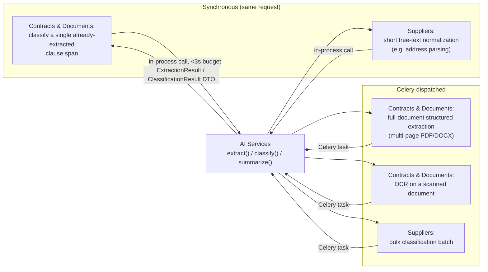
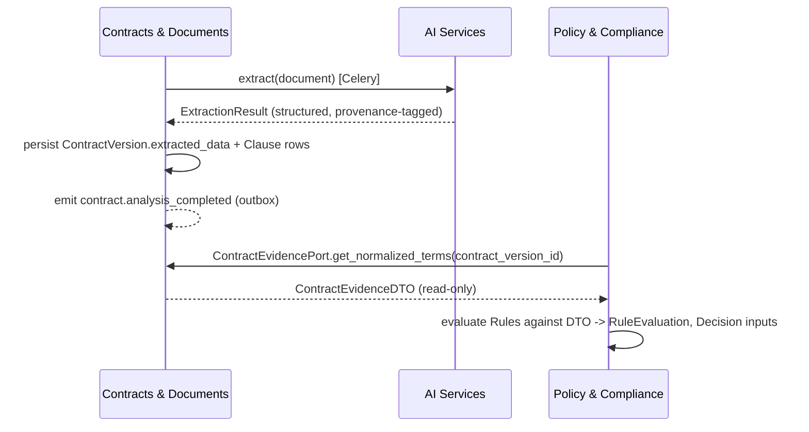

# AI Services — Architectural Placement

Where `AI Services` sits in the system, its call shape, and its hard boundary against ever deciding a
compliance outcome. **This file is about placement and boundaries, not the AI strategy itself** —
model selection, prompt design, RAG retrieval, evaluation, and provenance schema are
`docs/05-ai/ai-strategy.md`, `docs/05-ai/structured-extraction.md`, `docs/05-ai/document-intelligence.md`,
and `docs/05-ai/rag.md`'s job.

## 1. AI Services is a bounded context like any other

It is context #7 of 8 (`architecture-overview.md` §3), with the same `domain/application/
infrastructure/api` layering as every other context. What makes it different is not its internal
shape but its **role in the dependency graph**: it is a pure service context with (by design) almost
no persistent business state — it computes and returns structured results; it does not own an
aggregate that other contexts read back from later. See `components.md` §2 for its position in the
package dependency diagram.

## 2. Call shape: synchronous fast path vs. Celery-dispatched



The rule (also stated in `components.md` §5): **fast, single-call, small-input operations may be
called synchronously in the request/response cycle if the caller opts in and accepts the latency
budget; anything involving a multi-page document, OCR, or a batch is always Celery-dispatched.** The
caller — never `AI Services` itself — decides which path to use, because only the caller knows
whether it's inside a user-facing request or a background job.

## 3. Structured output only, always with provenance

Every `AI Services` call requires **structured output** (JSON schema / tool-calling), never freeform
text that a downstream context then has to parse (ADR-005). The returned DTO always carries
provenance metadata:

```python
# conceptual shape, app/ai_services/domain/results.py
class ExtractionResult:
    source_document_id: UUID
    provider: str            # "openai" | "anthropic"
    model: str                # exact model id used
    prompt_version: str
    fields: dict[str, ExtractedField]   # each field: value, page, text_span, confidence

class ExtractedField:
    value: Any
    page: int
    text_span: tuple[int, int]
    confidence: float
```

`AI Services` persists exactly one thing itself: a row in `ai_executions` (§ data-architecture.md §2)
per call — `provider`, `model`, `prompt_version`, `latency_ms`, `token_usage`/`cost_estimate`,
`organization_id`, timestamp — purely for cost tracking and provenance. It does **not** persist the
`ExtractionResult` payload itself; the caller does (e.g. `Contracts & Documents` writes it into
`ContractVersion.extracted_data` and creates the corresponding `Clause` rows).

## 4. The hard boundary: zero write access to decisioning data

**`AI Services` has zero write access to `Policy & Compliance` or `Approvals & Decisions` data —
enforced structurally, not just by convention**: `app/ai_services/` has no import path to
`app/policy/infrastructure/` or `app/approvals/infrastructure/`, and no port exposed by those
contexts is ever passed to `AI Services`. It publishes extraction/classification results; it never
calls anything that creates a `ComplianceReview`, `RuleEvaluation`, `Risk`, `ApprovalRequest`, or
`Decision` (`components.md` rules 4–5). This is the concrete implementation of the product principle
"AI is used for interpretation, classification, extraction, and summarization — never to
unilaterally decide a compliance outcome" (`docs/00-project/overview.md`).

Where AI-derived data *does* eventually influence a decision, the path is always indirect and always
passes back through a domain-owning context first:



`AI Services` is two hops removed from any `Decision`: it hands a structured result to the *domain*
context, which persists and owns it, and only then does `Policy & Compliance` read it — through a
port, never straight from `AI Services`. This also means a change in AI provider, model, or prompt
never requires touching `Policy & Compliance`'s evaluation logic at all, since it only ever sees the
already-normalized `ContractEvidenceDTO`/`SupplierEvidenceDTO` shape, not raw AI output.

## 5. What can go wrong and how it's handled

| Failure mode | Handling |
|---|---|
| Primary provider (say, OpenAI) errors or times out | Automatic fallback to the secondary provider (Anthropic) per ADR-005's gateway; the caller is unaware which provider ultimately answered — only `provider`/`model` in the returned DTO/`ai_executions` row records it |
| Both providers fail | The Celery task fails and retries with backoff; if a document's extraction never succeeds after the retry budget, `ContractVersion.extraction_confidence` is left unset and the `Contract`/`ComplianceReview` flow surfaces "extraction failed, manual review required" rather than silently proceeding with empty evidence |
| Low-confidence extraction (model returns a field but with low confidence) | Not `AI Services`' concern to gate — it returns the confidence value; `Policy & Compliance`'s rules (or `Contracts & Documents`' own validation) decide whether a low-confidence field should force a `REVIEW` outcome. This keeps the "what confidence is acceptable" decision inside the domain-owning/decisioning contexts, not inside the AI gateway |
| Schema-invalid model output (tool-calling result doesn't match the expected schema) | Rejected at the `AI Services` boundary itself (schema validation before returning), retried once against the same provider, then falls back to the secondary provider before failing the task — a downstream context must never receive a malformed `ExtractionResult` |
