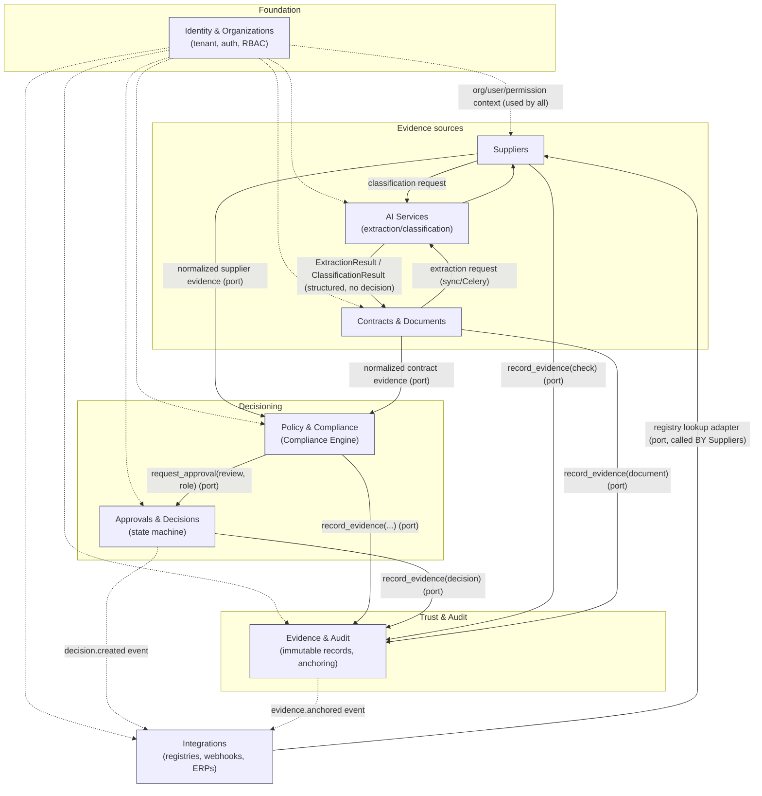

# Architecture Overview

> Status of the underlying decisions: this document narrates and ties together decisions already
> made in `docs/adr/ADR-001` through `ADR-016`. It does not re-decide anything; where an ADR is
> still `Proposed`/pending a spike, that status is carried over here verbatim.

## 1. What we are building

JuriSense Gate is a B2B compliance automation platform: it turns supplier data, contract text, and
company policy into an auditable `APPROVE / REVIEW / BLOCK` decision, backed by an evidence trail
that is independently verifiable (see `docs/00-project/overview.md`). Architecturally, that pipeline
maps onto eight bounded contexts, each owning one slice of the domain model
(`docs/03-domain/domain-model.md`).

## 2. Why a modular monolith (ADR-002)

Three constraints drove this: a small team, a hard hackathon deadline (Legal Hack 2026, judging
2026-11-05 to 2026-12-05), and an already-working, already-audited `Accounts` context
(`backend/app/accounts/`, ~2100 lines, tested, security-audited in `docs/auditorias/`) built on
Python 3.13 + FastAPI (ADR-001). Microservices would add network calls, distributed transactions,
and deployment overhead the team cannot absorb for a product with zero production traffic yet. A
single undifferentiated codebase would reproduce the coupling risk the pivot is explicitly trying to
avoid, given how many moving parts interact (supplier data, contract AI, policy evaluation,
approvals, evidence).

The resolution: **one deployable FastAPI application**, internally split into 8 Python packages
under `backend/app/`, each following the existing `domain/application/infrastructure/api` layering
that `app/accounts/` already established. Contexts talk to each other only through in-process
application-layer interfaces (ports) — never by importing another context's SQLAlchemy models or
querying its tables directly. The explicit, per-context-pair boundary rules live in
`components.md`; this document only states the principle and the resulting shape.

If a context's compute profile later diverges enough to need independent scaling — `AI Services` is
the most likely candidate, given its GPU/API-cost profile is unlike the rest — it can be extracted
into its own service later without a rewrite, because the port it exposes today is already the seam
a network boundary would replace.

## 3. The 8 bounded contexts

| # | Context | One-line responsibility | Package |
|---|---|---|---|
| 1 | **Identity & Organizations** | Tenant root, authentication, membership, RBAC-as-data. The foundation every other context depends on. | `app/identity/` (renamed from `app/accounts/`) |
| 2 | **Suppliers** | Registers and re-verifies third parties against registry/sanctions sources; owns the supplier lifecycle. | `app/suppliers/` |
| 3 | **Contracts & Documents** | Ingests documents, versions contracts, stores AI-extracted structured contract data with clause-level provenance. | `app/contracts/` |
| 4 | **Policy & Compliance** | Turns policy into executable rules; runs the Compliance Engine that produces the final rule-evaluation set. | `app/policy/` |
| 5 | **Approvals & Decisions** | Routes REVIEW outcomes to human approvers via a state machine; packages the final `Decision`. | `app/approvals/` |
| 6 | **Evidence & Audit** | Sole owner of immutable evidence, audit log, and blockchain anchoring. | `app/evidence/` |
| 7 | **AI Services** | Structured extraction/classification/summarization behind a provider-agnostic gateway. Never decides an outcome. | `app/ai_services/` |
| 8 | **Integrations** | Outbound adapters (Brazilian registries) and future inbound/outbound platform integrations (DocuSign, Slack, ERPs). Never writes to business tables directly. | `app/integrations/` |

`Identity & Organizations` is the one context every other context is allowed to depend on; it must
not depend back on any of them (see the dependency graph in `components.md` §2).

## 4. Top-level communication diagram

Solid arrows are synchronous port calls or Celery-dispatched jobs whose result flows back to the
caller; dotted arrows are read-only context (Identity) or fire-and-forget domain events (consumed
asynchronously, never awaited by the producer). The full allowed/forbidden dependency matrix is in
`components.md` §3.

## 5. Core Platform vs. Jurisdiction Packs

Brazil is the first market by design, not an architectural ceiling (`docs/00-project/overview.md`
§"Internationalization"; business-side sizing and expansion sequencing in
`docs/02-business/international-market.md`). The architecture keeps jurisdiction-specific logic out
of the core domain model by splitting responsibilities as follows:

| Layer | What lives here | Jurisdiction-specific? |
|---|---|---|
| **Core Platform** | The 8 bounded contexts' domain/application layers: `Supplier`, `Contract`, `Policy`, `ComplianceReview`, `Decision`, `Evidence` aggregates and their invariants; the CEL/JSONLogic rule evaluator (ADR-004); the decision aggregation algorithm (ADR-010); the approval state machine (ADR-006); the `AnchoringProvider` interface (ADR-007). | No. These are jurisdiction-agnostic by construction. |
| **Jurisdiction Pack — Brazil (first, and only one built today)** | `Suppliers` context's registry/sanctions **source adapters** (CNPJ via Receita Federal, CEIS, CNEP, CEPIM — see `integrations.md`); `Policy & Compliance`'s **seeded rule packs** expressing LGPD-specific conditions (e.g. "no DPA + processes personal data → BLOCK"); `Organization.tax_id` validation rules (CNPJ format/check-digit). | Yes, entirely. |
| **Future Jurisdiction Packs** (US/EU/UK/LATAM — business case in `docs/02-business/international-market.md`) | Same three seams as Brazil: a new `Suppliers` source adapter set (e.g. OFAC/SEC for the US, EU sanctions lists for the EU), a new seeded rule pack (GDPR-flavored conditions instead of LGPD), and a `tax_id` validator for the new jurisdiction's identifier format. | Yes, entirely. |

Concretely, this means: `Policy & Compliance`'s `Rule.when` expressions and `Suppliers`'
`RegistryLookupPort` implementations are the two extension points a new jurisdiction pack touches;
nothing in `Contracts & Documents`, `Approvals & Decisions`, `Evidence & Audit`, `AI Services`, or
`Identity & Organizations` needs to change to add a jurisdiction, because none of those contexts
encode jurisdiction-specific rules today. A new pack ships as: (1) a new adapter module under
`app/integrations/` implementing the existing `RegistryLookupPort`, (2) a new YAML rule-pack file
consumed by `Policy & Compliance`'s existing `PolicyVersion`/`Rule` model, (3) a new `tax_id`
validator registered against `Organization.jurisdiction`. No new bounded context, no schema
migration to the core tables.

## 6. Reading order for the rest of `04-architecture/`

1. `system-context.md` — who talks to the system from the outside.
2. `containers.md` — what runs, where, and how it's networked.
3. `components.md` — the 8 packages inside the FastAPI app, their explicit dependency rules,
   transaction and async boundaries.
4. `data-architecture.md` — who owns which table, multi-tenancy, storage.
5. `integrations.md`, `ai-architecture.md`, `blockchain-architecture.md` — the three external-facing
   subsystems in depth.
6. `security-architecture.md` — auth, tenant isolation, secrets.
7. `deployment.md` — how it actually runs on the VPS.
