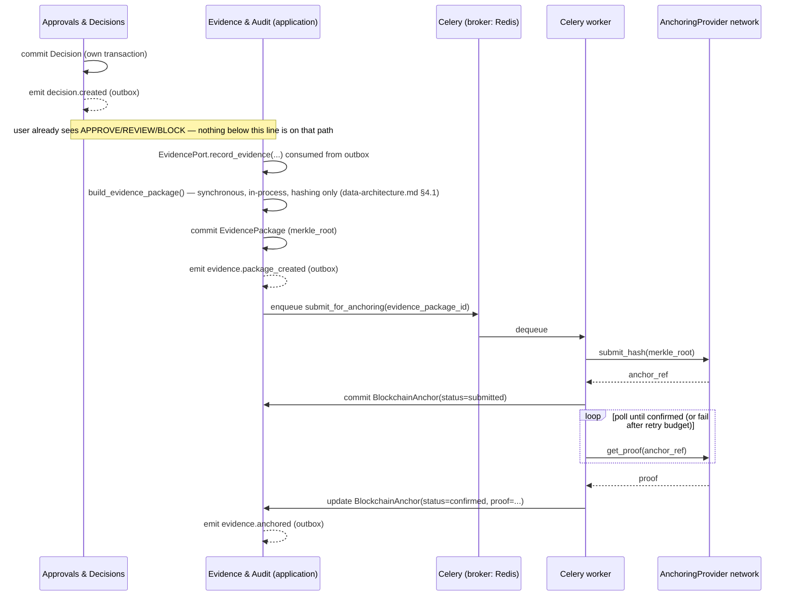

# Blockchain / Trust Layer — Architectural Placement

Where the Trust Layer sits architecturally, how it stays out of the way of the main compliance
decision flow, and how public verification works without authentication. **This file is about
placement, not the anchoring strategy itself** — the provider evaluation, privacy model (what never
gets hashed vs. what does), and the public verification page's product design are
`docs/06-blockchain/blockchain-purpose.md`, `docs/06-blockchain/privacy.md`, and
`docs/06-blockchain/verification.md`'s job respectively.

## 1. Ownership: the Trust Layer belongs to `Evidence & Audit`

There is no separate "Blockchain" bounded context. Anchoring is one responsibility of `Evidence &
Audit` (context #6, `architecture-overview.md` §3), which already owns `Evidence`, `EvidencePackage`,
and `AuditEvent` — `BlockchainAnchor` is simply the fourth entity it owns
(`docs/03-domain/domain-model.md`). This follows directly from `components.md` rule 12: **the
`AnchoringProvider` abstraction (ADR-007) is called exclusively by `Evidence & Audit`**; no other
context — including `Approvals & Decisions`, which produces the `Decision` that ultimately gets
anchored — talks to it directly.

```
app/evidence/
  domain/
    ports.py             # AnchoringProvider Protocol: submit_hash, get_proof, verify (ADR-007)
  infrastructure/
    anchoring/
      constellation_adapter.py   # candidate #1 (ADR-007 spike, Phase 8)
      evm_l2_adapter.py           # candidate #2, fallback
      icp_adapter.py               # candidate #3, evaluated only if spike shows low effort
  application/
    evidence_service.py    # record_evidence(), build_evidence_package()
    anchoring_service.py    # submit_for_anchoring() — Celery-dispatched, never inline
  api/
    public_verification.py  # GET /api/public/verify/{...} — no auth, see §4
```

## 2. Anchoring never blocks the compliance decision flow

This is the single most important architectural property of the Trust Layer: **a `Decision` is
final, visible, and actionable the moment `Approvals & Decisions` commits it — anchoring happens
strictly after, asynchronously, and its failure or delay never holds up the decision the user is
waiting on.**



Consequences of this shape:

- `EvidencePackage.created_at` and `Decision`-visible-to-user happen within the same request/response
  window (or immediately after, via the outbox dispatcher — sub-second in practice); `BlockchainAnchor`
  confirmation can legitimately take minutes depending on the underlying network's block time, and
  that is fine, because nothing in the product blocks on it.
- If the `AnchoringProvider` network is down or slow, the only visible effect is that a Decision
  Passport's "anchored" badge is pending/absent until the retried Celery task succeeds — the
  `Decision` itself, the `EvidencePackage`, and every other product function are completely
  unaffected. `BlockchainAnchor.status` starts at `submitted` and moves to `confirmed`/`failed`
  independently.
- A `failed` anchor (after the Celery task's retry budget is exhausted) does not invalidate the
  `Decision` or the `EvidencePackage` — the Merkle root is still deterministically recomputable from
  the immutable `Evidence` set at any time, so anchoring can be retried later (e.g. by an operator
  action or a scheduled sweep) without redoing anything upstream.

## 3. What gets hashed, never what's underneath

Only the `EvidencePackage`'s `merkle_root` — a hash — is ever submitted to `submit_hash()`. No raw
contract text, supplier PII, or policy content ever reaches the `AnchoringProvider` adapter or the
network itself; the full privacy argument and what specifically goes into the Merkle tree (document
hashes, `RuleEvaluation` ids, `SupplierCheck` result hashes) is `docs/06-blockchain/privacy.md`'s
content — architecturally, the enforcement point is that `AnchoringProvider.submit_hash()`'s
signature only accepts a hash type, never a document/text type, so there is no code path by which
`Evidence & Audit`'s `anchoring_service.py` could accidentally pass raw content even by mistake.

## 4. Public verification: reading anchored proof without authentication

The verification page's product behavior is `docs/06-blockchain/verification.md`'s content; this is
the architectural mechanism that makes "publicly checkable, no login required" safe.

```
GET /api/public/verify/{evidence_package_id}
```

This route lives in `app/evidence/api/public_verification.py` and is deliberately **excluded** from
the standard `get_current_membership()` auth dependency chain (`components.md` rule 10,
`security-architecture.md` §2) — it is the one documented carve-out in the entire API surface. It is
safe specifically because of what it is allowed to return:

| Field | Returned publicly? | Why |
|---|---|---|
| `evidence_package_id`, `merkle_root`, `created_at` | Yes | Not confidential; this is the whole point of a public proof |
| `BlockchainAnchor.provider`, `anchor_ref`, `proof`, `submitted_at`, `status` | Yes | The verifiable claim itself — a third party needs this to independently check the anchor against the public ledger |
| `Decision.status` (APPROVE/REVIEW/BLOCK) and `valid_until` | Yes, if the organization opts in (see below) | Optional — some organizations may want the passport link to prove *that* a decision was anchored without revealing *what* it was |
| Organization name | Yes, if opted in | Same opt-in as above |
| Any `Supplier`, `Contract`, `Clause`, `RuleEvaluation` content (names, terms, rationale) | **Never** | This is exactly the confidential business data the tenant boundary exists to protect; the public route's handler has no access to those repositories at all — not "filtered out," structurally absent from the query it runs |

Enforcement mechanism: `public_verification.py`'s handler calls **only** a narrow read port —
`EvidencePort.get_public_proof(evidence_package_id) -> PublicProofDTO` — whose return type
structurally cannot carry more than the table above, because the DTO class itself has no fields for
contract/supplier content. This is the same "read-only DTO across a boundary" pattern used everywhere
else in the system (`components.md` §3 rule 3), applied here across the authentication boundary
instead of a bounded-context boundary. An organization's opt-in for exposing `Decision.status` and
name (row above) is a flag on `EvidencePackage` (or `Organization` settings) checked inside
`get_public_proof()` itself — never a client-side filter, since the response must be safe even if a
malicious client bypasses the frontend entirely.

Because this route needs no `organization_id` scoping from an authenticated session, it takes the
`evidence_package_id` (a UUID, effectively unguessable) as its only input and is otherwise identical
in shape to a normal read endpoint — it does not need RLS, a separate database role, or a separate
service; it needs exactly one thing: a handler that never imports a repository capable of returning
confidential fields.

## 5. Failure handling summary

| Scenario | Behavior |
|---|---|
| `AnchoringProvider` adapter throws / times out on `submit_hash` | Celery task retries with backoff (bounded attempts); `BlockchainAnchor` stays absent/`submitted` until it succeeds or the task's retry budget is exhausted, at which point it's marked `failed` and surfaced to an operator for manual retry |
| `AnchoringProvider` network confirms slowly (normal for public chains) | `get_proof` polling loop (Celery task with its own re-enqueue/backoff, not a blocking wait) — `status` stays `submitted` until `confirmed` |
| Provider swap (per ADR-007's spike outcome) | Only `app/evidence/infrastructure/anchoring/*_adapter.py` changes; `AnchoringProvider` Protocol, `anchoring_service.py`, and the public verification DTO/route are all provider-agnostic and untouched |
| A `Decision` is superseded (`supersedes_decision_id` set) after its `EvidencePackage` was already anchored | The old anchor remains valid proof of what was true *at that time* — anchoring is never retroactively edited or deleted (consistent with `Evidence`/`EvidencePackage` immutability); the new `Decision` gets its own `EvidencePackage` and its own anchor |
