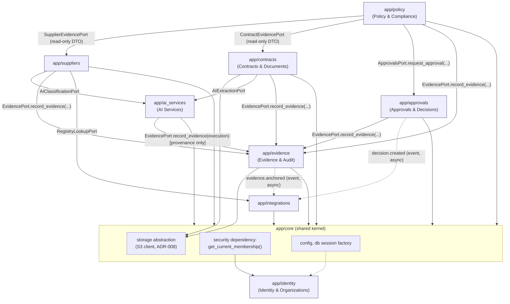

# Components

C4 Level 3 — the 8 bounded-context packages inside the "Backend API" / "Celery worker" containers
(`containers.md`), their allowed dependency arrows, and the transaction/async boundaries that make
"modular monolith" (ADR-002) mean something more than "one big folder." This is the file every other
`04-architecture/*` document points to for the boundary rules; treat it as the enforcement reference
during code review (`docs/07-engineering/coding-standards.md` documents the lint/review checklist
that operationalizes it).

## 1. Internal layering (per context, unchanged from `app/accounts/`)

Every context package follows the same four sub-layers, already established by
`backend/app/accounts/`:

```
app/<context>/
  domain/          # Entities, value objects, invariants, Protocol-typed ports. Zero I/O, zero framework imports.
  application/      # Use cases/services orchestrating domain + ports. Owns the transaction boundary (see §4).
  infrastructure/   # SQLAlchemy models, repositories, concrete port implementations (email, storage, external HTTP).
  api/              # FastAPI routers + Pydantic schemas. Depends on application, never on another context's infrastructure.
```

A context's `api/` layer may depend on its own `application/` layer and on `app/core/` (shared
kernel: settings, DB engine/session factory, the `get_current_membership()` auth dependency that
wraps `Identity & Organizations`). It must never import another context's `infrastructure/` or
`domain/` module directly.

## 2. Component diagram: package dependencies



Solid arrows: synchronous or Celery-dispatched **port calls** — the caller depends on the callee's
`application/`-exposed interface (typically a `Protocol` defined in the callee's own `domain/ports.py`
or a small shared-contract module, never on the callee's ORM models). Dotted arrows: **domain
events**, consumed asynchronously by whoever subscribes; the producer never blocks on or knows who
consumes them.

## 3. Explicit boundary rules

These are binding, not illustrative — a PR that violates one of these is a defect, full stop, and
`docs/07-engineering/coding-standards.md`'s review checklist checks for it.

1. **Suppliers must not import or query `Contracts & Documents`' ORM models** (`Document`,
   `Contract`, `ContractVersion`, `Clause`) under any circumstance, including read-only queries. If
   `Suppliers` ever needs contract data (not currently required by the domain model), it must go
   through a `ContractEvidencePort` exposed by `Contracts & Documents`' `application/` layer.

2. **`Contracts & Documents` must not import or query `Suppliers`' ORM models** (`Supplier`,
   `SupplierProfile`, `SupplierCheck`) directly; the reverse of rule 1. `ContractVersion.contract_id
   → Contract.supplier_id` is the only allowed link, and it is a plain foreign-key value, not a
   cross-context join executed from `Contracts & Documents`' repositories.

3. **`Policy & Compliance` may read `Suppliers` and `Contracts & Documents` data only through
   read-only application-layer ports** — `SupplierEvidencePort.get_normalized_profile(supplier_id) ->
   SupplierEvidenceDTO` and `ContractEvidencePort.get_normalized_terms(contract_version_id) ->
   ContractEvidenceDTO` — that return plain DTOs, never SQLAlchemy model instances from those
   contexts. This is the concrete mechanism behind the domain-model-level rule "`Suppliers` and
   `Contracts & Documents` publish normalized evidence consumed by `Policy & Compliance`."

4. **`AI Services` must not write to any table owned by `Policy & Compliance` or `Approvals &
   Decisions`**, and has no persistent business-domain tables of its own beyond an internal
   `ai_executions` provenance log (`data-architecture.md` §2). It returns structured
   `ExtractionResult`/`ClassificationResult` DTOs to whichever context called it; that caller persists
   the result into its own schema (e.g. `Contracts & Documents` writes the DTO into
   `ContractVersion.extracted_data`). This is the concrete mechanism behind "`AI Services` never
   decides final compliance outcomes."

5. **`AI Services` must never call anything that creates a `ComplianceReview`, `RuleEvaluation`, or
   `Decision`.** Those types are created exclusively by `Policy & Compliance` (`ComplianceReview`,
   `RuleEvaluation`) and `Approvals & Decisions` (`Decision`) application-layer use cases, triggered
   by an explicit user or scheduled action — never as a side effect of an AI call returning.

6. **`Policy & Compliance` must not call `Approvals & Decisions`' repository or ORM models
   directly to create an `ApprovalRequest`.** It must invoke `ApprovalsPort.request_approval(review_id,
   required_role, severity) -> ApprovalRequestRef` on `Approvals & Decisions`' `application/` layer.
   Symmetrically, **`Approvals & Decisions` must not query `Policy & Compliance`'s `RuleEvaluation`
   table directly**; if it needs evaluation detail for a UI (e.g. showing an approver *why* review was
   triggered), it calls `Policy & Compliance`'s own read port
   (`ComplianceReviewPort.get_review_summary(review_id)`), never a raw join.

7. **`Evidence & Audit` is the only context permitted to write to `Evidence`, `EvidencePackage`,
   `AuditEvent`, and `BlockchainAnchor`.** Every other context that needs to record evidence or an
   audit trail entry calls `EvidencePort.record_evidence(type, ref_id, content_hash)` /
   `AuditPort.emit(event_type, actor_id, payload)` — both exposed by `Evidence & Audit`'s
   `application/` layer — never an `INSERT` against those tables from another context's repository.

8. **`Integrations` must never write to `Supplier`, `Contract`, `Policy`, `ComplianceReview`,
   `ApprovalRequest`, `Decision`, or `Evidence` tables**, matching the domain-model-level invariant on
   the `Integration` entity itself ("never writes directly to business-domain tables"). An inbound
   webhook (e.g. DocuSign "envelope completed") is translated by `Integrations`' `application/` layer
   into an explicit command executed through the *owning* context's own application layer — e.g. a
   `MarkContractSigned` command dispatched to `Contracts & Documents`, not a direct `UPDATE
   contracts SET status = 'signed'`.

9. **`Suppliers` is the only caller of `Integrations`' `RegistryLookupPort`** for CNPJ/CEIS/CNEP/CEPIM
   lookups; `Integrations` owns the outbound HTTP adapters and response parsing, but `Suppliers` owns
   and persists the resulting `SupplierCheck` record. `Integrations` never persists a `SupplierCheck`
   itself (see `integrations.md` §2 for the full split).

10. **`Identity & Organizations` must not depend on any other bounded context** — it is the
    foundation (`architecture-overview.md` §3). No other context may bypass it and implement its own
    JWT validation, permission-grid lookup, or tenant-scoping logic; every API route in every context
    obtains the authenticated `Membership` (with `organization_id` and `role`) through
    `app/core`'s `get_current_membership()` dependency, which itself calls into `Identity &
    Organizations`' `application/` layer — never a hand-rolled equivalent.

11. **Object storage access is not routed through `Integrations`.** Per ADR-008, the S3-compatible
    storage abstraction is shared infrastructure (`app/core/storage.py`) used directly by `Contracts &
    Documents` (documents) and `Evidence & Audit` (evidence packages); `Integrations` has no role in
    document/evidence persistence.

12. **The `AnchoringProvider` abstraction (ADR-007) is owned and called exclusively by `Evidence &
    Audit`.** No other context — including `Approvals & Decisions`, which produces the `Decision`
    that triggers anchoring — talks to the `AnchoringProvider` interface directly; it calls
    `EvidencePort.record_evidence(...)` and lets `Evidence & Audit` decide when/how to anchor (see
    `blockchain-architecture.md`).

## 4. Transaction boundaries

**Rule: each context's writes are transactional within itself; cross-context consistency is achieved
through domain events and idempotent port calls, never a distributed transaction or a single
SQLAlchemy session spanning two contexts' tables — even though, physically, all contexts share one
Postgres database.** This is a deliberate constraint, not a technical necessity of the database
layout: sharing one Postgres instance would technically allow a single ACID transaction across, say,
`Policy & Compliance` and `Approvals & Decisions` tables, but doing so would silently reintroduce the
coupling that the bounded-context split exists to prevent, and would break the moment either context
is later extracted into its own service (ADR-002 §Consequences).

Concretely:

- Each `application/` layer use case opens exactly one SQLAlchemy session/transaction scoped to
  **its own context's tables**, commits (or rolls back) it, and only then — if at all — invokes
  another context's port. A port call is a **separate** call after the caller's own commit, not
  inside its transaction.
- When a use case must guarantee that a state change and an outbound effect (a domain event, an
  audit record, a Celery task dispatch) happen together reliably, it uses the **transactional outbox
  pattern**: the use case writes its own aggregate's row(s) *and* an `outbox_events` row in the same
  local transaction, then a separate dispatcher (a Celery beat–scheduled task, see `containers.md`)
  polls `outbox_events` and delivers each event at least once (in-process pub/sub call, or a Celery
  task enqueue) before marking it dispatched. This avoids the classic "DB commit succeeded, event
  publish failed" bug without needing a message broker with transactional guarantees.
- Example: `Policy & Compliance` completing a `ComplianceReview` with a `REVIEW` outcome (1) commits
  `ComplianceReview` + `RuleEvaluation` rows + an `outbox_events` row for `compliance.review_completed`
  in one transaction, then (2) — either inline right after commit, or picked up by the outbox
  dispatcher — calls `ApprovalsPort.request_approval(...)`, which is itself a **separate** transaction
  owned by `Approvals & Decisions` that commits its own `ApprovalRequest` row.
- Failure handling: if step (2) fails (network hiccup, `Approvals & Decisions` momentarily
  unavailable — unlikely in-process, but the pattern must survive the later extraction case too), the
  outbox row stays undispatched and is retried; the `ComplianceReview` itself is already durably
  committed and does not need to be rolled back or redone. This is why the review's completion and
  the approval request are modeled as two transactions, not one: a failure in the second must never
  threaten the first.

## 5. Async boundaries: synchronous API call vs. Celery-dispatched

| Operation | Sync (in request/response) | Celery-dispatched | Owning context |
|---|---|---|---|
| Login, token refresh, permission check | Yes | — | Identity & Organizations |
| CRUD on `Supplier`, `Contract`, `Policy` metadata | Yes | — | Suppliers / Contracts & Documents / Policy & Compliance |
| Document upload (persist file + `Document` row) | Yes (upload itself); triggers async processing after | Yes — OCR/text extraction pipeline kicks off after upload commits | Contracts & Documents |
| AI structured extraction on a full contract | — | **Yes**, always — multi-page documents routinely exceed a reasonable request timeout | AI Services (dispatched by Contracts & Documents) |
| AI classification on short text (e.g. clause type of an already-extracted span) | Yes, if the caller opts into a synchronous fast path (small input, single model call) | Optionally, if batched | AI Services |
| Supplier registry/sanctions lookup (CNPJ/CEIS/CNEP) | — | **Yes**, always — external API latency/availability is out of our control | Integrations (adapter) called from a Suppliers Celery task |
| Compliance Engine rule evaluation itself | **Yes** — deterministic, in-process, no I/O, evaluates already-available normalized evidence | — (only the evidence-gathering steps before it are async) | Policy & Compliance |
| Approval request creation, approve/reject action | Yes | — | Approvals & Decisions |
| Approval reminder / timeout sweep | — | **Yes**, scheduled via Celery beat | Approvals & Decisions |
| Notification email dispatch (invite, password reset, approval notice) | — | **Yes** | Identity & Organizations / Approvals & Decisions |
| `EvidencePackage` construction from a finalized `Decision` | **Yes** — synchronous, fast, no external I/O (hashing/Merkle root over already-collected evidence refs) | — | Evidence & Audit |
| Blockchain anchoring (`BlockchainAnchor` submission) | — | **Yes**, always, dispatched right after `EvidencePackage` commits — never blocks the decision response (`blockchain-architecture.md` §2) | Evidence & Audit |
| Outbox event dispatch | — | **Yes**, Celery-beat-polled | Shared pattern, `app/core` |
| Inbound webhook processing (DocuSign, Slack, future) | Fast ack synchronously (HTTP 200 to the caller), then | **Yes** — actual command execution against the owning context is dispatched async | Integrations |

The dividing line is deliberate and matches ADR-006's split of "short-lived background tasks" (Celery)
vs. "the decision/approval state itself" (DB-backed state machine, evaluated synchronously): anything
that calls an external system, processes a large document, or is not needed to answer the current
HTTP request goes to Celery; anything that is a fast, deterministic, in-process state change stays
synchronous.

## 6. Domain event catalog (cross-context only)

This is the subset of the full event catalog (`docs/03-domain/audit.md`) that crosses a context
boundary — i.e. has a consumer in a different package than its producer. Events with no
cross-context consumer (e.g. `user.login_failed`) are internal to their context and not listed here.

| Event | Producer | Consumer(s) | Delivery |
|---|---|---|---|
| `supplier.check.completed` | Suppliers | Policy & Compliance (invalidates/refreshes evidence for open reviews) | Outbox → async |
| `contract.analysis_completed` | Contracts & Documents | Policy & Compliance (evidence now available to evaluate) | Outbox → async |
| `compliance.review_required` | Policy & Compliance | Contracts & Documents / Suppliers (nothing to persist, informational) and triggers a new `ComplianceReview` | Outbox → async |
| `compliance.review_completed` | Policy & Compliance | Approvals & Decisions (may trigger `request_approval`), Evidence & Audit (audit log) | Outbox → async |
| `approval.approved` / `approval.rejected` | Approvals & Decisions | Policy & Compliance (review record cross-reference), Evidence & Audit (audit log) | Outbox → async |
| `decision.created` / `decision.overridden` | Approvals & Decisions | Evidence & Audit (builds `EvidencePackage`), Integrations (future webhook fan-out) | Outbox → async |
| `evidence.package_created` | Evidence & Audit | (internal trigger for anchoring Celery task) | Outbox → async |
| `evidence.anchored` | Evidence & Audit | Integrations (future webhook fan-out), notifies the requesting user | Outbox → async |
| `membership.revoked` | Identity & Organizations | All contexts (nothing to persist; existing sessions/permission cache entries invalidated) | Outbox → async |

Every row in this table is an **outbox-pattern** delivery (§4) — none of these are delivered inside
the producer's own DB transaction, and none require the consumer to be available at publish time.
