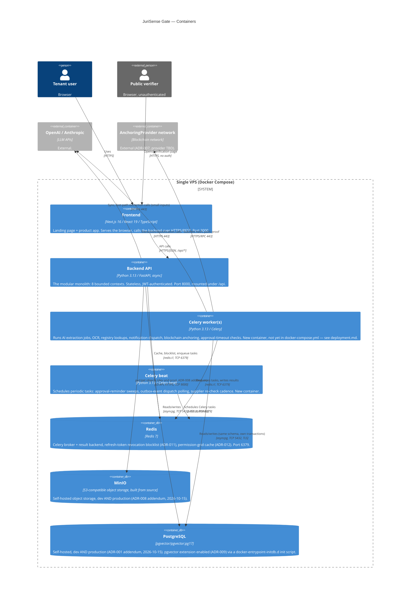

# Containers

C4 Level 2 — the deployable units, grounded in `docker-compose.yml`, `backend/Dockerfile`, and
`frontend/Dockerfile` as they exist today, plus what ADR-006/ADR-007/ADR-008 require us to add. See
`deployment.md` for how these containers map onto the actual VPS, and `components.md` for what's
inside the "Backend API" and "Celery worker" containers.

## 1. Diagram

## 2. Container inventory

| Container | Tech | Port(s) | State | In `docker-compose.yml` today? |
|---|---|---|---|---|
| Frontend | Next.js 16, `output: "standalone"`, distroless Node 24 runtime | 3000 | Stateless | Yes (`frontend` service, `dev` target for hot reload) |
| Backend API | FastAPI, uv-managed, Python 3.13 | 8000 | Stateless (all state in Postgres/Redis/storage) | Yes (`backend` service, `dev` target) |
| Celery worker | Same image as backend, different entrypoint (`celery -A app.core.celery_app worker`) | none exposed | Stateless | Yes (`celery-worker` service) |
| Celery beat | Same image as backend, `celery -A app.core.celery_app beat` | none exposed | Stateless (schedule persisted in Redis/DB) | Yes (`celery-beat` service) |
| Redis | `redis:7-alpine` | 6379 | Stateful (`redis_data` volume) | Yes, with healthcheck (`condition: service_healthy`) |
| PostgreSQL | `pgvector/pgvector:pg17` | 5432 | Stateful (`postgres_data` volume) | Yes (`postgres` service, ADR-001 addendum 2026-10-15 -- self-hosted, dev and production) |
| MinIO | Built from source (`./minio/Dockerfile`), dev and production | 9000 (S3 API), 9001 (console) | Stateful (`minio_data` volume) | Yes (`minio`/`minio-init` services, ADR-008 addendum 2026-10-15) |

External (not containers on this VPS):

| System | Tech | Reached via | State |
|---|---|---|---|
| OpenAI / Anthropic (interim: OpenRouter) | LLM APIs | HTTPS REST, API keys from environment | N/A |
| AnchoringProvider network | Blockchain (provider TBD, ADR-007) | Provider SDK/RPC, HTTPS | N/A (append-only ledger, not ours to manage) |

PostgreSQL and object storage were external (Neon, Cloudflare R2) until the 2026-10-15 ADR-001/
ADR-008 addenda moved both to self-hosted containers above -- see those addenda for why.

## 3. Backend API vs. Celery worker: why the same image, two entrypoints

The backend image (`backend/Dockerfile`, `runner` stage) already builds a clean `python:3.13-slim`
image with the app code and the `uv`-resolved virtualenv baked in. The Celery worker and beat
containers reuse **the exact same image**, just with a different `CMD` (`celery -A
app.core.celery_app worker --loglevel=info` / `celery -A app.core.celery_app beat`) — no separate
Dockerfile, no separate dependency set. This keeps the two processes guaranteed to run identical
application code and avoids drift between "what the API imports" and "what the worker imports"; both
import all 8 context packages, since a Celery task dispatched by `Contracts & Documents` and one
dispatched by `Evidence & Audit` both need to run in the same worker pool. Both services build
from `{ context: ./backend, target: dev }` (dev, `docker-compose.yml`) / the `runner` stage
(production, `docker-compose.prod.yml`), sharing the `backend/.env` env file like `backend` does.

## 4. Protocols and ports, end to end

| Hop | Protocol | Port | Notes |
|---|---|---|---|
| Browser → Frontend | HTTPS | 443 (Cloudflare) → 3000 (container) | Cloudflare terminates TLS at the edge in production; see `deployment.md` |
| Frontend → Backend API | HTTPS/REST, JSON | 443 → 8000 | `NEXT_PUBLIC_API_URL`, prefixed `/api`; CORS restricted to `CORS_ORIGINS` (`app/core/config.py`) |
| Backend API / Worker → PostgreSQL | PostgreSQL wire protocol via `asyncpg` | 5432 | TLS via `ssl` param, normalized from libpq `sslmode` (`app/core/config.py::_normalize_database_url`) -- a no-op against the self-hosted instance's plain URL, kept for any future managed-Postgres use |
| Backend API / Worker / Beat → Redis | RESP (`redis://`) | 6379 | Broker + result backend (Celery), revocation blocklist, permission-grid cache |
| Backend API / Worker → Object storage | S3 API over HTTPS | 9000 | Self-hosted MinIO, same endpoint/credentials shape in dev and production (ADR-008 addendum) |
| Worker → AI providers | HTTPS/REST | 443 | Long-running extraction; Backend API also calls AI providers directly for small, low-latency tasks (see `ai-architecture.md` §2) |
| Worker → AnchoringProvider | HTTPS or chain RPC, provider-specific | 443 (typical) | Only from `Evidence & Audit`'s Celery tasks, never from the request/response cycle (`blockchain-architecture.md`) |
| Public verifier → Backend API | HTTPS/REST | 443 → 8000 | Unauthenticated `GET /api/public/verify/{...}` route only — see `security-architecture.md` §5 |

## 5. What changed vs. the original `docker-compose.yml` (historical, now executed)

This section originally described a target state the repo hadn't reached yet (no worker/beat, no
object storage, external Neon). All of it has since landed: `celery-worker`/`celery-beat` services
exist; object storage is self-hosted MinIO, not s3mock, in both dev and production (ADR-008
addendum, 2026-10-15); PostgreSQL is self-hosted too (ADR-001 addendum, same date). The current
`docker-compose.yml` (dev) and `docker-compose.prod.yml` (production overlay) are the source of
truth for the actual service list — kept here only as a record of the sequence, not as a to-do.

The pre-pivot `documents_data`/`/dados/empresas` VPS-filesystem volume's removal (superseded by
object storage) is still tracked separately in `data-architecture.md` §4 — unrelated to the
infrastructure-hosting changes above.
