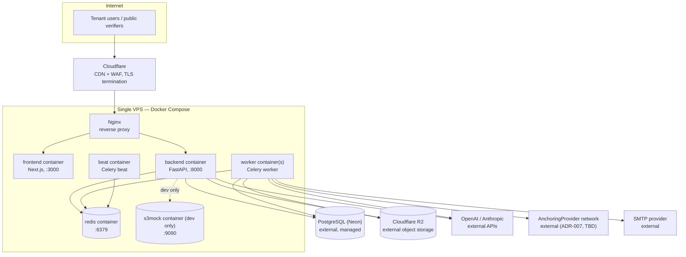

# Deployment Architecture

How JuriSense Gate actually runs, consistent with the project's established hosting philosophy:
**a single VPS running Docker Compose, with only the database, the AI provider APIs, object storage,
and the anchoring network as external dependencies.** This document states what's unchanged from the
pre-pivot hosting decision and what the pivot adds — see `containers.md` for the container-level
detail this builds on.

## 1. Diagram

## 2. Unchanged from the pre-pivot hosting decision

These were decided before the pivot to JuriSense Gate and remain exactly as they were:

- **Single VPS, Docker Compose** as the deployment unit — no Kubernetes, no multi-node orchestration.
  Justified by the same reasoning as ADR-002 (modular monolith): small team, tight timeline, no
  production traffic yet to justify the operational overhead of a distributed platform.
- **External managed PostgreSQL (Neon)** — `docker-compose.yml` runs no local Postgres; `DATABASE_URL`
  lives in `backend/.env` (gitignored), loaded via `env_file`, normalized libpq→asyncpg by
  `app/core/config.py::_normalizar_database_url`. Nothing about the pivot changes this — it was
  already the case before the domain changed from legal-ERP to compliance automation.
  Postgres is now additionally required to have the `pgvector` extension enabled (ADR-009) — an
  extension flag on the same managed instance, not a new external dependency.
- **External AI provider APIs** (OpenAI/Anthropic) reached over HTTPS — the "VPS + external DB +
  external AI APIs" philosophy stated in `docs/00-project/overview.md`'s Technology strategy section
  and in ADR-008's own framing ("consistent with the... hosting philosophy already established for
  this project") predates the pivot and is exactly what this deployment keeps.
- **Redis on the VPS itself** (not external) — `redis:7-alpine` container, healthchecked, with a
  named volume (`redis_data`). Unchanged.
- **Cloudflare fronting the VPS** as CDN/WAF, terminating TLS at the edge before traffic reaches the
  VPS's Nginx reverse proxy. Unchanged in principle (the current `docker-compose.yml` doesn't yet
  include an `nginx` service — that's a pre-existing gap in the dev compose file, not a pivot-specific
  one; the target production topology has always assumed it, per the plan captured in
  `docs/00-project/overview.md`'s "Planned Architecture" framing carried from `CLAUDE.md`).

## 3. Newly added by the pivot

- **Celery worker + Celery beat containers** (ADR-006) — new services in `docker-compose.yml`, built
  from the same `backend` image with a different entrypoint (`containers.md` §3). Needed because the
  pre-pivot product had no async task processing requirement of this shape; JuriSense Gate's AI
  extraction, registry lookups, and blockchain anchoring all require it.
- **Object storage** (ADR-008): **s3mock** as a new dev-only container (`containers.md` §5) and
  **Cloudflare R2** as a new *external* dependency in production — added alongside Neon Postgres and
  the AI provider APIs as the third external service the VPS depends on. This directly supersedes the
  pre-pivot plan of storing documents on the VPS filesystem under `/dados/empresas/{organizacao_id}/`
  with encrypted off-VPS backups (still reflected in the current `documents_data` Docker volume) —
  object storage gets versioning and durability "for free" instead of hand-rolled backup scripting
  (ADR-008's own stated rationale). The `documents_data` volume is not deleted immediately; it is
  phased out as new uploads move to R2/s3mock (`data-architecture.md` §4.2, `containers.md` §5).
- **`AnchoringProvider` network egress** (ADR-007): a new category of *outbound-only* external
  dependency — the VPS's Celery workers make outbound HTTPS/RPC calls to submit hashes and poll
  proofs (`blockchain-architecture.md` §2). No inbound connection from the anchoring network is ever
  required, which keeps this addition low-risk from a network-exposure standpoint: it is one more
  outbound allowlist entry on the VPS firewall, not a new listening port.
- **pgvector extension** on the existing Neon instance (ADR-009) — not a new service, but a new
  requirement on the existing external database (confirm the extension is enabled per environment;
  Neon supports it natively).

## 4. What did not change and was never going to

- No move to Cloud Run/Cloud SQL/Pub/Sub or any GCP-native service — those describe the *old*
  architecture docs (`docs/_legacy/IMPLEMENTACAO_ARQUITETURA/`), explicitly superseded by the VPS
  decision (see `CLAUDE.md`'s "Known Documentation Inconsistencies"). Nothing in the pivot to
  JuriSense Gate reopens that question.
- No move away from FastAPI/Next.js — ADR-001 reaffirms Python/FastAPI specifically because of the
  already-built, already-audited `Accounts` context; the pivot changes the *domain*, not the
  *stack*.

## 5. Environment variables added to `backend/.env` / `docker-compose.yml` for the pivot

Building on the existing `Settings` class (`app/core/config.py`), the following new settings groups
are required (exact field names are an implementation detail, listed here for completeness of the
deployment picture, not as a frozen contract):

| Group | Purpose | Dev default | Prod requirement |
|---|---|---|---|
| `CELERY_BROKER_URL` / `CELERY_RESULT_BACKEND` | Point Celery at Redis | Reuses `REDIS_URL` | Same pattern, required |
| `OBJECT_STORAGE_ENDPOINT` / `_ACCESS_KEY` / `_SECRET_KEY` / `_BUCKET_DOCUMENTS` / `_BUCKET_EVIDENCE` | S3-compatible client config (ADR-008) | Points at the `s3mock` container | Points at Cloudflare R2, required, no dev default |
| `AI_PROVIDER_OPENAI_API_KEY` / `AI_PROVIDER_ANTHROPIC_API_KEY` | AI Gateway credentials (ADR-005) | Required even in dev (no mock provider planned for realistic testing) | Required |
| `ANCHORING_PROVIDER` / `ANCHORING_PROVIDER_CREDENTIALS` | Selects and authenticates the `AnchoringProvider` adapter (ADR-007) | Dev/test can point at a testnet | Points at whichever network the Phase 8 spike selects |

Every one of these follows the existing pattern in `app/core/config.py`: added as a `Settings` field
with a safe dev default where one exists, and — for anything security-sensitive (API keys, storage
credentials, anchoring credentials) — validated as required and non-placeholder when
`environment == "production"`, mirroring `_exige_segredo_em_producao`'s existing check for
`JWT_SECRET_KEY` (`security-architecture.md` §4).
