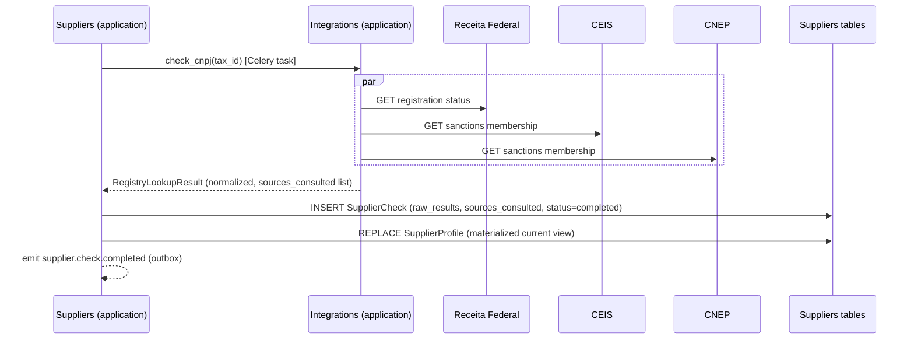

# Integrations Architecture

External integration architecture for JuriSense Gate. This document maps the **full** external
dependency surface (so nothing is invisible), but is precise about which pieces are actually owned by
the `Integrations` bounded context and which are owned elsewhere by explicit ADR decision — conflating
these would contradict `components.md`'s boundary rules and the `Integration` entity's own invariant
("never writes directly to business-domain tables," `docs/03-domain/domain-model.md`).

## 1. Ownership map — what is (and isn't) in the `Integrations` context

| Integration | Owned by | Why |
|---|---|---|
| Brazilian registry/sanctions adapters (CNPJ, CEIS, CNEP, CEPIM) | **`Integrations`** (adapter code) — but the resulting record is persisted by `Suppliers` | Suppliers is the domain owner of `SupplierCheck`; `Integrations` only knows how to talk to the outside world (§2) |
| Future webhook/integration platform (DocuSign, Slack, ERPs) | **`Integrations`** | This is the canonical "integration platform" role — inbound/outbound, provider-agnostic dispatch (§4) |
| AI provider gateway (OpenAI/Anthropic) | **`AI Services`**, per ADR-005 | The AI Gateway is defined as living inside `AI Services`, not `Integrations` — see `ai-architecture.md` and `docs/05-ai/ai-strategy.md` for the strategy itself; described only briefly here (§3) for a complete external-surface picture |
| Object storage adapter (R2/MinIO) | **Shared kernel (`app/core/storage.py`)**, used directly by `Contracts & Documents` and `Evidence & Audit`, per ADR-008 | Not an "integration" in the business sense — it's core infrastructure every context that touches files needs; routing it through `Integrations` would make document upload depend on a context that has no business reason to be in that path (§3) |
| `AnchoringProvider` adapter (blockchain) | **`Evidence & Audit`**, per ADR-007 | Anchoring is intrinsic to the Trust Layer's own responsibility, not a generic outbound integration — see `blockchain-architecture.md` (§3) |
| Email provider (SMTP) | **`Identity & Organizations`** (invites, password reset — already built) and **`Approvals & Decisions`** (notifications) | Pre-existing, domain-agnostic infrastructure concern, not routed through `Integrations` |

The rule this table encodes: **`Integrations` is where we put adapters for systems whose entire
purpose is talking to an external counterparty on the business's behalf** (a government registry, a
partner's e-signature platform, a customer's Slack workspace) — not every technical dependency that
happens to be "external" in a deployment-topology sense (object storage, the DB, an LLM API are
external too, but they're infrastructure the owning context needs to do its own job, not a
counterparty relationship the business manages).

## 2. Brazilian registry/sanctions adapters (Jurisdiction Pack — Brazil)

Architecture shape:

```
app/integrations/
  domain/ports.py        # RegistryLookupPort Protocol (defined here since Integrations owns the impl)
  infrastructure/
    cnpj_adapter.py       # Receita Federal CNPJ lookup — registration status, corporate structure
    ceis_adapter.py        # CEIS sanctions list lookup
    cnep_adapter.py        # CNEP sanctions list lookup
    cepim_adapter.py       # CEPIM (impeded entities) lookup
  application/
    registry_lookup_service.py   # Fans out to the 4 adapters, normalizes into one RegistryLookupResult
```

```python
# app/integrations/domain/ports.py (conceptual signature)
class RegistryLookupPort(Protocol):
    async def check_cnpj(self, tax_id: str) -> RegistryLookupResult: ...
```

Call sequence (a supplier re-check, Celery-dispatched per `components.md` §5):



`Integrations` never writes `SupplierCheck` or `SupplierProfile` rows — it returns a DTO, and
`Suppliers`' own `application/` layer performs the persistence and the invariant enforcement
("`SupplierCheck` immutable once completed," "`SupplierProfile` always reflects the most recent
successful check" — `docs/03-domain/domain-model.md`).

**Failure handling**: each adapter call has its own timeout and retry policy (exponential backoff,
max 3 attempts) independent of the others — a CEIS outage must not block a CNPJ-only refresh. A
source that fails after retries is recorded in `sources_consulted` with a `failed` status and a
`SupplierCheck.status` of `completed` (partial) rather than `failed`, unless **zero** sources
succeeded, in which case the whole `SupplierCheck` is `failed` and is retried by the Celery task's own
retry policy. Adapter response caching (short TTL, e.g. 24h) avoids hammering public registries on
repeated checks of the same `tax_id` within a short window.

## 3. AI provider gateway and object storage — architectural shape only (owned elsewhere)

- **AI provider gateway** (OpenAI/Anthropic): lives in `app/ai_services/infrastructure/` as
  provider adapters behind one internal interface (`extract()`, `classify()`, `summarize()`),
  config-driven provider selection per task type, automatic fallback to a secondary provider on
  error/timeout (ADR-005). Full strategy — model selection, prompt versioning, cost thresholds — is
  `docs/05-ai/ai-strategy.md`'s job; the architectural placement is `ai-architecture.md`'s. It is
  listed here only so the external-dependency map in `system-context.md` is traceable to an owner.
- **Object storage adapter** (R2/MinIO): lives in `app/core/storage.py`, a thin
  `put_object`/`get_object`/`generate_presigned_url` wrapper over the S3 API, instantiated once per
  process with environment-driven endpoint/credentials (MinIO endpoint in dev, R2 endpoint + access
  keys in prod). `Contracts & Documents` and `Evidence & Audit` both hold a reference to it; neither
  re-implements S3 client logic.

## 4. Future integration platform: DocuSign, Slack, ERPs

Not built yet — this is the target shape for when it is, so it lands inside the `Integrations`
boundary from day one rather than being bolted onto whichever context needs it first.

```
app/integrations/
  domain/
    ports.py            # OutboundIntegrationPort (send_webhook, send_message), InboundEventHandler
  application/
    webhook_dispatch_service.py    # Subscribes to outbox events (decision.created, evidence.anchored, ...),
                                     # maps to provider-specific payloads, sends via the provider adapter
    inbound_webhook_service.py     # Verifies signature, translates payload into a command, dispatches
                                     # it to the OWNING context's application layer
  infrastructure/
    docusign_adapter.py
    slack_adapter.py
    erp_adapter.py        # generic; concrete ERP TBD per customer
  api/
    webhooks.py           # POST /api/integrations/webhooks/{provider} — inbound receiver
```

**Outbound flow** (e.g. notify Slack on `decision.created`): `Integrations`' `webhook_dispatch_service`
is a subscriber on the outbox dispatcher (`components.md` §4/§6) for events an `Integration` row
(`organization_id`-scoped, `status=active`) has opted into; it never queries `Approvals & Decisions`'
tables to get decision detail beyond what the event payload already carries (the event payload is
the DTO — this preserves rule 8 in `components.md`).

**Inbound flow** (e.g. DocuSign "envelope completed"): the webhook lands on `POST
/api/integrations/webhooks/docusign`, is authenticated (provider signature, not tenant JWT — this is
a machine-to-machine callback), resolved to an `organization_id`/`Contract` via the envelope's
stored external reference, and translated into an explicit command —
`MarkContractSigned(contract_id, signed_at, signer_refs)` — dispatched through `Contracts &
Documents`' own `application/` layer. `Integrations` never issues the `UPDATE contracts ...`
directly; it only ever calls the owning context's public use case, exactly like every other
cross-context caller in this system (`components.md` rule 8).

**Status: TBD** for which provider ships first (DocuSign vs. a lighter e-signature API vs. Slack
notifications only) — *Current preferred option*: Slack notifications first (lowest integration
effort, highest visible demo value), DocuSign second. *Why undecided*: no customer commitment yet
that requires e-signature integration specifically; roadmap phase not yet reached (see
`docs/09-planning/roadmap.md`). *Resolution*: revisit once Phase 9+ (post-hackathon expansion) is
scoped with real customer input. *Decision artifact*: a future ADR-017, not yet written.
