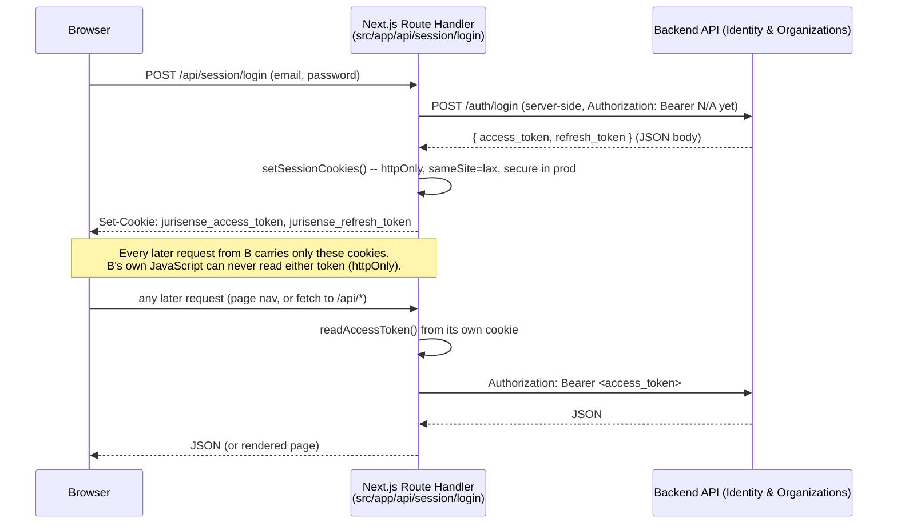

# Security Architecture

This document is the **architectural** security spec: where auth, authorization, and tenant checks
sit in the request path, and how secrets are managed. It is distinct from
`docs/07-engineering/security.md`, which covers day-to-day security practices, the sprint-audit
checklist (ADR-016), and specific hardening tasks — this file defines the enforcement points those
practices verify against.

## 1. Authentication flow (JWT + rotating refresh, ADR-011)

Carried over unchanged from the existing, tested, and audited `Accounts`/`Identity & Organizations`
implementation:

```mermaid
sequenceDiagram
    participant U as User (browser)
    participant API as Backend API (Identity & Organizations)
    participant R as Redis

    U->>API: POST /api/auth/login (email, password)
    API->>API: verify Argon2id hash, check lockout (Redis-backed, RF01: 5 attempts / 15 min)
    API-->>U: access_token (JWT, 15 min) + refresh_token (opaque/rotating, 7 days)
    U->>API: subsequent requests with Authorization: Bearer <access_token>
    API->>API: verify JWT signature + expiry (stateless, no Redis round-trip)
    Note over API: access token carries user_id; organization_id/role resolved per-request<br/>from the active Membership, not baked into the token (a user can hold multiple memberships)
    U->>API: POST /api/auth/refresh (refresh_token)
    API->>R: check refresh token jti not in revocation blocklist
    API->>R: rotate: blocklist old jti, issue new refresh_token + new access_token
    API-->>U: new token pair
```

- Access tokens are short-lived (15 min) and stateless — validating one costs no Redis round-trip,
  which matters because every single API request validates one.
- Refresh tokens rotate on every use and are checked against a Redis-backed revocation blocklist
  keyed by `jti`; a stolen-and-reused refresh token is detectable (reuse of an already-rotated `jti`)
  and treated as a signal to revoke the whole token family (implementation detail owned by `Identity
  & Organizations`, `docs/07-engineering/security.md` covers the operational response).
- Trade-off accepted explicitly by ADR-011: immediate access-token revocation is not guaranteed
  within the 15-minute window. This is a deliberate, documented trade-off, not an oversight.

## 2. Authorization enforcement point: the API layer, before any command executes

**RBAC is checked at the API layer, as a FastAPI dependency, strictly before the request reaches any
`application/` layer use case — never inside a use case, never at the repository layer, never
client-side.** This is ADR-003/ADR-012's "RBAC as data" model made concrete:

```python
# conceptual shape, app/core/security.py
async def get_current_membership(
    token: str = Depends(oauth2_scheme),
    organization_id: UUID = Depends(get_organization_from_path_or_header),
) -> AuthenticatedMembership:
    """Validates the JWT, resolves the caller's Membership for this organization_id,
    and raises 401/403 before the route function body ever runs."""
    ...

def require_permission(module: str, action: str):
    """Dependency factory: raises 403 if the resolved Membership's permission grid
    (role default + per-user override) doesn't grant module x action."""
    async def _check(membership: AuthenticatedMembership = Depends(get_current_membership)):
        if not membership.can(module, action):
            raise HTTPException(403, "forbidden")
        return membership
    return _check
```

Every route in every context (except the one documented carve-out, §5) declares its required
`module`/`action` as a route-level dependency — e.g. `POST /api/policies` depends on
`require_permission("policies", "create")`. Because this is a FastAPI dependency, it runs and can
short-circuit with a 401/403 **before** the route function — and therefore before any
`application/` layer call — ever executes. An `application/` layer use case is never reachable
without having already passed this check; there is no second, informal authorization path.

The permission grid itself (`module` × `action` per `role`, with per-user overrides — ADR-012) is
persisted data, cached in Redis per `(user_id, organization_id)` with invalidation on
`membership.revoked`/`role.permissions_updated` (`data-architecture.md` §4.3), and read by
`Identity & Organizations`' `application/` layer — `get_current_membership()`/`require_permission()`
in `app/core` are thin wrappers that call into it; they contain no authorization logic of their own.

## 3. Tenant isolation enforcement point: the repository layer

**Every query in every context's `infrastructure/repositories.py` is scoped by `organization_id`,
sourced from the `AuthenticatedMembership` resolved in §2 — never from a client-supplied value taken
at face value.** This is `data-architecture.md` §3's rule, restated here as a security boundary: the
`organization_id` used to scope a query comes from the **token-derived, server-resolved** membership,
not from a request body/query-param `organization_id` the client could tamper with (a client-supplied
`organization_id` in a URL path is only ever used to *select which of the caller's own memberships*
applies — `get_current_membership()` rejects it with 403 if the caller has no `Membership` for that
`organization_id` at all, before any repository call happens).

This means tenant isolation has exactly one enforcement layer to audit, not several inconsistent
ones scattered per context — every sprint's mandatory cross-tenant-access test (ADR-003, ADR-016)
targets this layer specifically.

## 4. Secrets management

**Environment-based per environment, never in code or git** — the pattern already established and
followed:

- Local dev: `backend/.env` (gitignored), loaded via `env_file` in `docker-compose.yml`; the file
  ships a `.env.example` with placeholder values, never real secrets.
- `app/core/config.py` refuses to boot in `production` with the dev-default `JWT_SECRET_KEY` or one
  shorter than 32 bytes (`_exige_segredo_em_producao` validator) — a fail-closed check, not just a
  documentation note.
- Production (VPS): secrets (`DATABASE_URL`, `JWT_SECRET_KEY`, AI provider API keys, object storage
  credentials, `AnchoringProvider` credentials, SMTP credentials) are injected as environment
  variables on the host (or a secrets file mounted outside the image, outside version control),
  never baked into the Docker image and never committed. `deployment.md` §3 covers the operational
  side of this.
- New secrets introduced by the pivot (object storage keys, AI provider keys, `AnchoringProvider`
  credentials) follow the exact same pattern as the existing `DATABASE_URL`/`JWT_SECRET_KEY`/SMTP
  settings already in `Settings` (`app/core/config.py`) — added as new `Settings` fields with safe
  (non-functional) dev defaults where possible, required and validated in production.
- Secret rotation (JWT signing key, provider API keys) is an operational runbook item
  (`docs/07-engineering/security.md`), not an architectural concern beyond noting that access tokens'
  short 15-minute life bounds the blast radius of a leaked `JWT_SECRET_KEY` signature-forging window
  to already-issued-but-unexpired tokens if rotation is done promptly.
- `INTEGRATION_CREDENTIALS_ENCRYPTION_KEY` (added 2026-10-10, closing the H1 follow-up on
  encrypting `Integration.config`'s connector credentials at rest, not just masking them in API
  responses): a symmetric Fernet key, same env-var pattern as above. A managed KMS (envelope
  encryption, rotation without re-encrypting data, a decrypt audit trail) was considered and
  deliberately deferred — no real connector exists yet to need the plaintext back (EPIC-9 is
  post-hackathon) and no VPS/cloud account is provisioned yet to host one. Revisit if a real
  enterprise customer's security review requires it (ties into EPIC-10's "harden multi-tenancy"
  scope); `app/integrations/infrastructure/credential_encryption.py`'s own docstring repeats this
  so the decision travels with the code, not only the doc.

## 5. Security boundary diagram: where checks happen in the request path

```mermaid
flowchart TB
    C["Client (browser / public verifier)"]
    CF["Cloudflare (CDN/WAF, TLS termination)"]
    FE["Next.js frontend container"]
    CORS["FastAPI CORSMiddleware<br/>(CORS_ORIGINS allowlist)"]
    AUTH["get_current_membership()<br/>JWT verify + Membership resolve"]
    RBAC["require_permission(module, action)<br/>permission-grid check"]
    APP["application/ layer<br/>(use case)"]
    REPO["infrastructure/repositories.py<br/>organization_id-scoped query"]
    DB[("PostgreSQL")]
    PUB["public_verification.py<br/>(NO auth/RBAC — narrow DTO only,<br/>see blockchain-architecture.md §4)"]

    C -->|HTTPS| CF
    CF -->|HTTPS| FE
    CF -->|HTTPS /api/*| CORS
    CORS --> AUTH
    AUTH -->|401 if invalid/expired| C
    AUTH --> RBAC
    RBAC -->|403 if not permitted| C
    RBAC --> APP
    APP --> REPO
    REPO -->|organization_id always applied| DB

    CORS -->|"/api/public/verify/* only"| PUB
    PUB -->|"read-only, structurally narrow DTO"| DB

    classDef gate fill:#fee,stroke:#944,stroke-width:1px;
    class AUTH,RBAC gate;
    classDef bypass fill:#eef,stroke:#446,stroke-dasharray: 4 4;
    class PUB bypass;
```



The diagram makes the one intentional bypass visually explicit rather than hiding it: every route
passes through `AUTH` → `RBAC` → tenant-scoped `REPO`, **except** the single public verification
route, which is deliberately routed around both gates because its response type structurally cannot
carry confidential data (`blockchain-architecture.md` §4) — it is not that authorization was
forgotten there, it is that the route was designed from the start to not need it, backed by the same
DTO-boundary discipline used for every cross-context call in `components.md`.

## 6. Frontend BFF: cookie-based session, and why it isn't vulnerable to CSRF

#129 (security/pentest QA round, 2026-09-28): the frontend never was, and still isn't, a
cookie-session client of the backend API — `docs/07-engineering/security.md`'s "the API is a
stateless, `Authorization: Bearer` JWT API (not cookie-session-based)" statement remains exactly
true of the backend itself. What exists, and was never written down anywhere until this section,
is a second trust boundary *in front of* that one: the Next.js frontend acting as a
Backends-for-Frontends (BFF) for the browser.



The browser holds a session **cookie**; the backend still only ever sees a **Bearer header**,
attached server-side, inside the Next.js container, never by the browser itself. `backend.ts` (the
one module allowed to call the backend) is marked `import "server-only"`, which fails the build if
any Client Component ever imports it — so this boundary is enforced at compile time, not just by
convention.

### CSRF threat model for this specific boundary

The classic CSRF attack — a malicious page makes the victim's browser submit a state-changing
request to an app the victim is logged into, relying on the browser auto-attaching that app's
session cookie — applies to the **Browser ↔ Route Handler** leg above, since that's the only leg
with a cookie in play. It does not apply to the **Route Handler ↔ backend** leg (no browser, no
cookie, nothing for an attacker's page to ride along on).

Three independent properties jointly close this off, none of them hypothetical — each verified
against this exact codebase, not assumed:

1. **`sameSite: "lax"`** (`src/lib/auth/cookie-config.ts`) — a `lax` cookie is never attached to a
   cross-site `POST`/`PUT`/`PATCH`/`DELETE` request (only to a cross-site top-level `GET`
   navigation, e.g. clicking a link). Every mutating route under `src/app/api/` uses one of those
   four methods; **none** of the handful of `GET` route handlers
   (`compliance/reviews`, `compliance/reviews/[id]`, `users/invites`) changes any state — confirmed
   by reading every `route.ts` in the codebase, the exact "state-changing GET" gap this ticket
   asked to rule out or close. So the `lax` default alone already stops the classic vector.
2. **An explicit `Origin`/`Sec-Fetch-Site` check** (`src/lib/auth/csrf.ts`, enforced centrally in
   `src/proxy.ts` for every `/api/*` request) — a second, independent layer that doesn't depend on
   the browser correctly honoring a cookie attribute. Rejects any non-`GET`/`HEAD`/`OPTIONS` request
   whose `Sec-Fetch-Site` is anything but `same-origin`/`none`, or — if that header is absent —
   whose `Origin` doesn't match the request's own `Host` header. Every mutation this app
   itself ever sends is a same-origin `fetch()` (every `<form>` uses `onSubmit` + `fetch`, never a
   native `action=`/`method=` submission), so this never has a legitimate reason to fail; a request
   with neither header, or a mismatched one, is rejected (403) rather than assumed safe.
3. **No endpoint anywhere trusts a cookie's mere presence as authorization** — every Route Handler
   still has to successfully read a non-expired, structurally valid access token from the cookie
   (`readAccessToken()`) and have the backend accept it as a real `Authorization: Bearer` header;
   a forged request riding on an attacker's page has no path to a cookie value it doesn't already
   have (httpOnly), so even a hypothetical gap in (1) or (2) would still need a real token to do
   anything with the cookie that did ride along.

### Decision

No CSRF token was added. Given (1) and (2) above are both real, verified, and independent (a gap
in one doesn't defeat the other), and there is no state-changing `GET` for `sameSite=lax`'s own
residual gap to matter against, a CSRF token would be a third redundant layer protecting against a
vector that's already closed twice — not a response to any identified gap. Revisit this decision
if a future route ever needs state-changing behavior on `GET`, or if a client not subject to
`fetch`'s header behavior (e.g. a native mobile app hitting these same Route Handlers) is ever
added.

## 7. Summary of enforcement points

| Concern | Enforcement point | Mechanism |
|---|---|---|
| Authentication | API layer, first dependency in the chain | JWT signature/expiry check (stateless), refresh rotation + Redis blocklist |
| Authorization (RBAC) | API layer, second dependency, before any use case runs | Permission-grid lookup (role default + per-user override), Redis-cached |
| Tenant isolation | Repository layer, every query | Mandatory `organization_id` parameter sourced from the resolved `Membership`, never from client input taken at face value |
| Cross-context data access | Application layer (ports/DTOs) | `components.md` boundary rules — irrelevant to auth, but a second, independent line of defense against a confidential field leaking through an unintended path |
| Secrets | Deploy-time environment injection | `.env` (dev, gitignored) / host environment variables (prod), fail-closed validation in `Settings` |
| Public verification carve-out | API layer, one specific route | No auth/RBAC dependency at all; safety comes from the response DTO's structural narrowness, not from a permission check |
| CSRF (frontend BFF cookie session) | Next.js Proxy, every `/api/*` route handler | `sameSite=lax` cookies + explicit `Origin`/`Sec-Fetch-Site` same-origin check (§6) — the backend API itself remains Bearer-only and is never exposed to this threat model at all |
