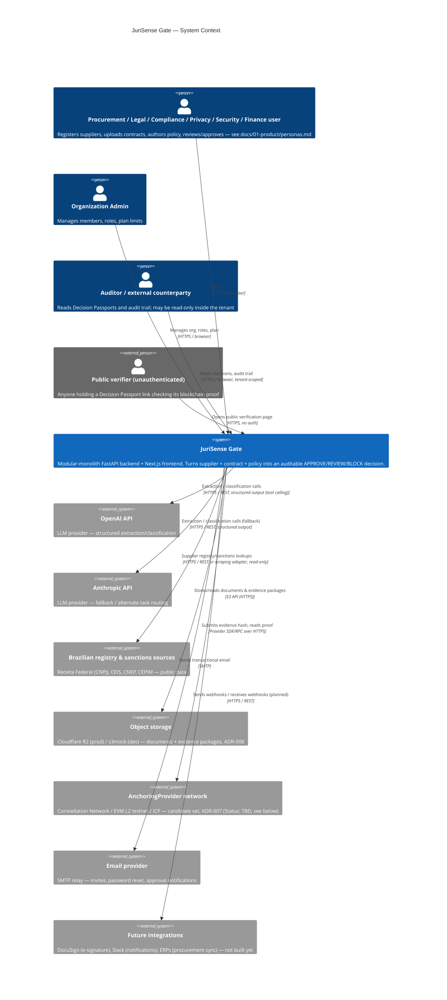

# System Context

C4 Level 1 — how JuriSense Gate sits between its users and the outside systems it depends on. See
`architecture-overview.md` for the internal breakdown and `containers.md` for the next zoom level.

## 1. Diagram

## 2. Actors

| Actor | Type | What they do | Auth |
|---|---|---|---|
| Procurement / Legal / Compliance / Privacy / Security / Finance user | Internal, tenant member | Day-to-day product use: register suppliers, upload/review contracts, author policy, act as approver (`docs/01-product/personas.md`) | JWT, RBAC-scoped to their `Membership.role` (ADR-003, ADR-011) |
| Organization Admin | Internal, tenant member with `Admin` role | Manages members, invites, roles, plan/subscription limits | JWT, `Admin` role required for admin-only endpoints |
| Auditor / external counterparty (e.g. an M&A due-diligence reviewer) | Internal, tenant member, typically `Viewer`/`Auditor` role | Reads Decision Passports and the audit trail; does not create/edit compliance data | JWT, read-only role grant |
| Public verifier | External, unauthenticated | Opens a Decision Passport's public verification link and checks the anchored proof against the `AnchoringProvider` network | None — see `blockchain-architecture.md` §4 for the deliberate no-auth carve-out and `security-architecture.md` §5 for why this doesn't weaken tenant isolation |

## 3. External systems

| System | Direction | Purpose | Owning bounded context | Notes |
|---|---|---|---|---|
| OpenAI API | Outbound | Structured extraction, classification, summarization | `AI Services` | ADR-005. Selected per task type via config; see `ai-architecture.md` |
| Anthropic API | Outbound | Same as above, secondary/fallback provider | `AI Services` | Automatic fallback on error/timeout (ADR-005) |
| Brazilian registry & sanctions sources (CNPJ/CEIS/CNEP/CEPIM) | Outbound | Verify supplier registration status, corporate structure, sanctions/restriction list membership | `Integrations` (adapter) → consumed by `Suppliers` (owns the resulting `SupplierCheck`) | Jurisdiction Pack — Brazil, see `architecture-overview.md` §5 and `integrations.md` §2 |
| Object storage (R2 prod / s3mock dev) | Outbound | Durable, versioned storage for uploaded documents and immutable evidence packages | `Contracts & Documents` and `Evidence & Audit` directly (shared storage abstraction, not routed through `Integrations` — ADR-008) | See `data-architecture.md` §4 |
| AnchoringProvider network | Outbound | Anchor Evidence Package hashes for third-party-verifiable tamper-evidence | `Evidence & Audit` | ADR-007. **Status: TBD / Current preferred option: Constellation Network, then a generic EVM L2 testnet (Base Sepolia or Polygon Amoy), then ICP/Caffeine AI, in that order / Why undecided: no adapter has been benchmarked yet; the choice depends on SDK maturity and integration effort discovered during the Phase 8 spike / Resolution: implement and benchmark at least one adapter during Phase 8 of the roadmap / Decision artifact: ADR-007, to be updated to Accepted after the spike.** |
| Email provider | Outbound | Transactional email: invites, password reset, approval notifications | `Identity & Organizations` (invites/password reset, reused from `Accounts`) and `Approvals & Decisions` (notifications) | SMTP today (`backend/app/core/config.py`'s `smtp_*` settings); logs to console when unset in dev |
| Future integrations (DocuSign, Slack, ERPs) | Bidirectional | E-signature completion webhooks, chat notifications, procurement system sync | `Integrations` | Not built yet; architectural shape defined in `integrations.md` §4 |

## 4. What's explicitly out of scope for this diagram

Court/tribunal integrations, CNJ process-number tooling, and ICP-Brasil digital signatures were part
of the pre-pivot legal-ERP product and are **not** part of JuriSense Gate's external surface. If you
find references to them elsewhere in the repository (older docs, `docs/_legacy/`), they describe the
superseded product, not this one.
