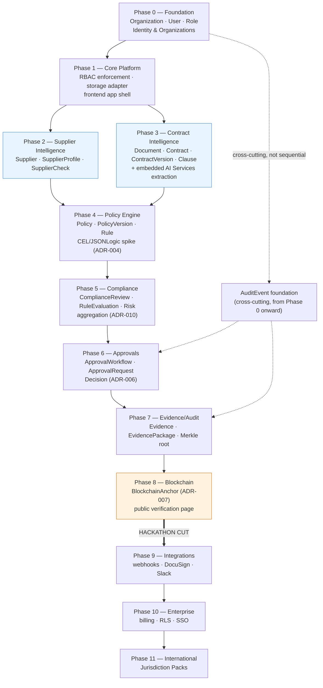

# Dependency Graph

This document makes explicit which capability must exist before which other capability can be
built, and — just as importantly — which capabilities have **no** direct dependency on each other
and can therefore be built by different people at the same time. See `roadmap.md` for the full
phase detail this graph summarizes, and `backlog.md`/`milestones.md` for how it maps to concrete
work items and calendar time.

## Graph

## Reading the graph

**The hard sequential spine** is: Identity & Organizations / multi-tenancy (Phase 0) → RBAC +
platform substrate (Phase 1) → Documents/Contracts and Supplier data existing at all → Contract
Intelligence (Phase 3) → Policy Engine (Phase 4) → Compliance evaluation (Phase 5) → Approvals
(Phase 6) → Decision → Evidence (Phase 7) → Anchoring (Phase 8). Each of these genuinely cannot
start before its predecessor produces the data or substrate it consumes:

- The Policy Engine's evaluation context (`docs/03-domain/policy-engine.md`) is built by normalizing
  `Supplier`/`SupplierProfile`/`SupplierCheck` fields **and** `ContractVersion.extracted_data`/
  `Clause` fields into one flat context. It cannot be meaningfully built, let alone tested with real
  data, until both Suppliers (Phase 2) and Contracts & Documents (Phase 3) exist.
- Compliance (`ComplianceReview`/`RuleEvaluation`, `ADR-010`) evaluates a published `PolicyVersion`
  against that normalized context — it cannot exist before Policy (Phase 4).
- Approvals (`ApprovalRequest`, `ADR-006`) route a `REVIEW` outcome from a completed
  `ComplianceReview` — it cannot exist before Compliance (Phase 5).
- Evidence (`EvidencePackage`, Merkle root) packages a real `Decision` — it cannot exist before
  Approvals/Decisions (Phase 6).
- Blockchain anchoring (`BlockchainAnchor`, `ADR-007`) anchors a real `EvidencePackage`'s hash — it
  cannot exist before Evidence (Phase 7).

**What CAN be parallelized:**

- **Supplier Intelligence (Phase 2) and Contract Intelligence (Phase 3) do not depend on each
  other.** `Supplier`/`SupplierProfile`/`SupplierCheck` and `Document`/`Contract`/`ContractVersion`/
  `Clause` are independent aggregates in independent bounded contexts (`Suppliers` vs. `Contracts &
  Documents`); neither entity references the other, and neither feature's API/UI needs the other to
  exist. Only `Policy & Compliance` (Phase 4) depends on **both** of them being done, because it is
  the first component that needs to reason about supplier evidence and contract evidence together.
  This is the single highest-value parallelization opportunity in the whole roadmap: two engineers
  (or two work-streams) can run Phase 2 and Phase 3 concurrently and lose zero calendar time to
  false sequencing, provided both converge before Phase 4 starts.
- **AI Services** is not a sequential phase at all — it is embedded inside Phase 3 (the extraction
  pipeline) and, once built, is a reusable capability the rest of the roadmap calls into (e.g., a
  future summarization feature on the Decision Passport) without gating any other phase's start.
- **The `AuditEvent` foundation is cross-cutting, not a phase gate.** It is established in Phase 0
  and then extended incrementally by every later phase as new event types are added (Identity events
  in Phase 0, Supplier events in Phase 2, Contract events in Phase 3, and so on through Approvals and
  Evidence). No phase blocks on "audit is done" the way Phase 4 blocks on "Suppliers and Contracts
  are done" — audit coverage is a per-phase exit-criterion line item, not a separate phase in the
  critical path.
- **RBAC seeding (Phase 1) and the storage adapter (Phase 1) are also not on each other's critical
  path** — they can be built by different people within Phase 1 and both simply need to land before
  Phase 2/3 start consuming them.
- **Within Phase 9–11 (post-hackathon)**, Integrations work and early Enterprise hardening items
  (e.g., RLS) have no hard ordering dependency on each other either — they are sequenced in
  `roadmap.md` primarily for commercial-priority reasons (a stable integration layer helps close
  enterprise deals), not a technical blocker. A team with spare capacity could pull RLS hardening
  forward into Phase 9 without breaking anything.

**What must NOT be parallelized**, even though it might look tempting under hackathon time
pressure: starting Policy Engine (Phase 4) work against a partially-built Supplier or Contract data
shape. Because the evaluation-context normalizer is a direct, literal mapping from those two
contexts' output fields, building it against a moving target produces rework, not time saved — this
is the specific trap the sequential spine above exists to prevent.
