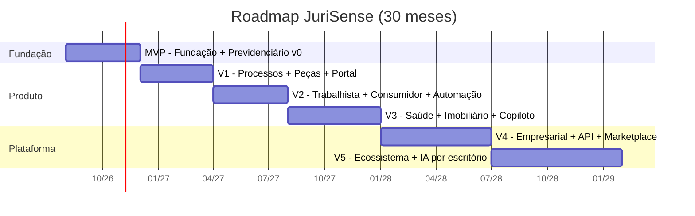
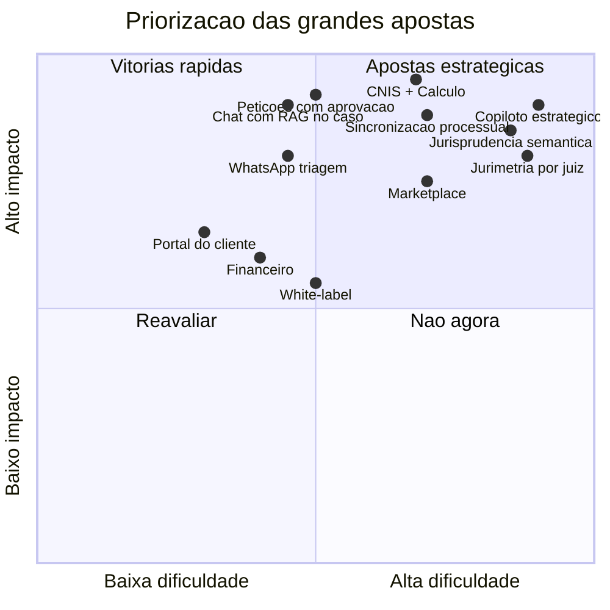
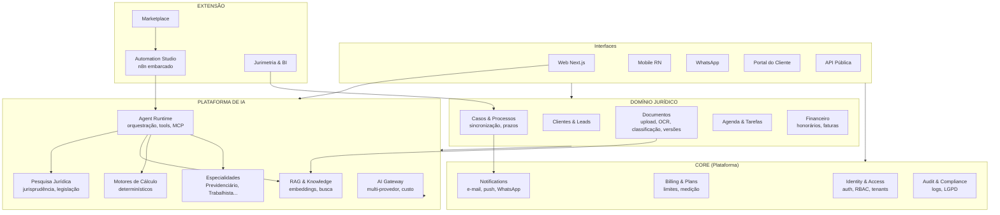
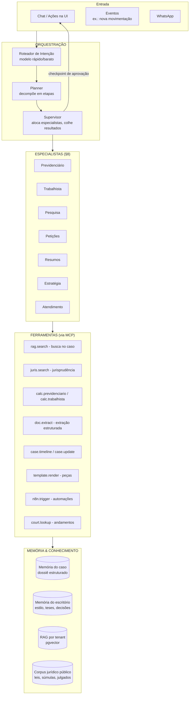
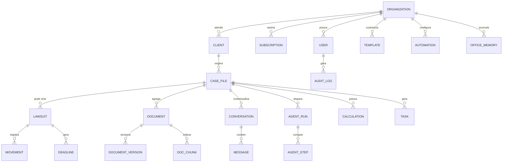
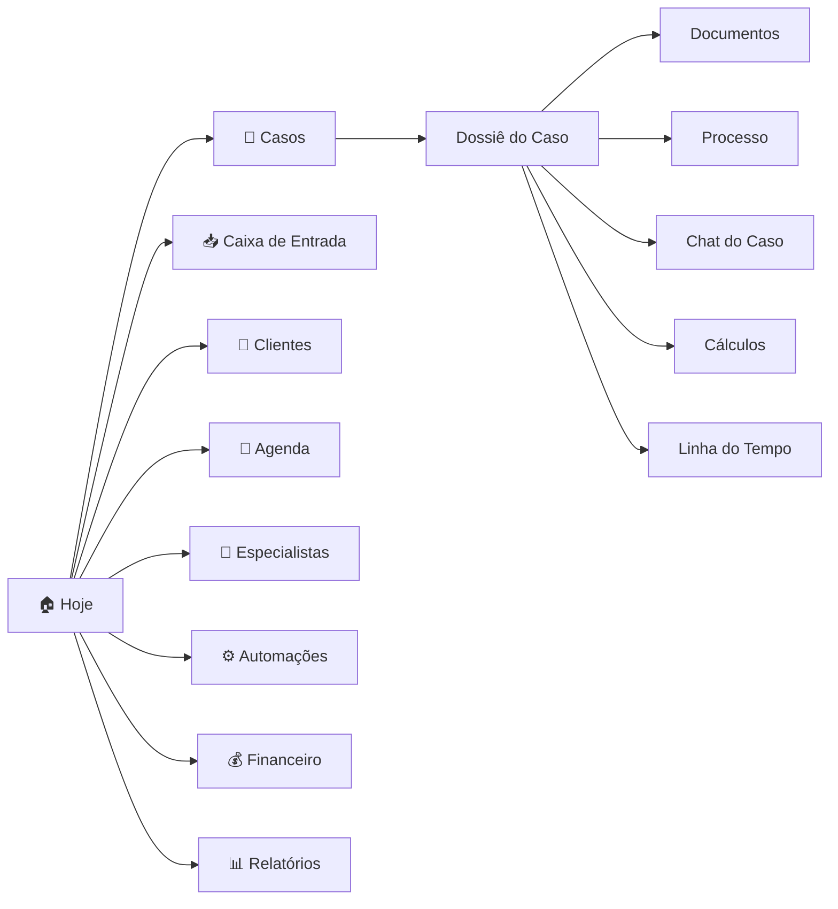
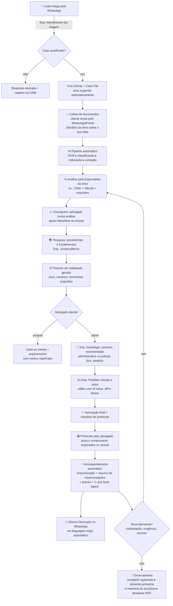
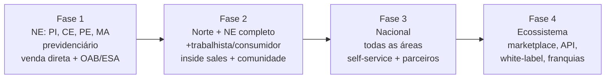
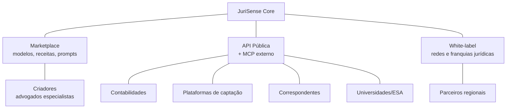

# 🧭 PLANO DE EVOLUÇÃO DO JURISENSE

## O Sistema Operacional Jurídico orientado por IA do Norte/Nordeste → Brasil

**Versão:** 1.0
**Data:** 06/07/2026
**Autores:** Produto + Engenharia + Design JuriSense
**Status:** Proposta para aprovação

---

## Índice

1. [Sumário Executivo](#1-sumário-executivo)
2. [Visão e Posicionamento](#2-visão-e-posicionamento)
3. [Roadmap Completo (MVP → V5)](#3-roadmap-completo-mvp--v5)
4. [Arquitetura de Módulos](#4-arquitetura-de-módulos)
5. [Arquitetura de IA](#5-arquitetura-de-ia)
6. [Arquitetura de Banco de Dados](#6-arquitetura-de-banco-de-dados)
7. [UX — A Experiência do Advogado](#7-ux--a-experiência-do-advogado)
8. [Especialistas de IA](#8-especialistas-de-ia)
9. [Fluxo de Trabalho Ponta a Ponta](#9-fluxo-de-trabalho-ponta-a-ponta)
10. [Diferenciais Competitivos](#10-diferenciais-competitivos)
11. [Funcionalidades Inovadoras](#11-funcionalidades-inovadoras)
12. [Plano Técnico Consolidado](#12-plano-técnico-consolidado)
13. [Plano de Crescimento](#13-plano-de-crescimento)
14. [Escalabilidade](#14-escalabilidade)
15. [Organização do Projeto (Pastas e Padrões)](#15-organização-do-projeto-pastas-e-padrões)
16. [Visão de Longo Prazo](#16-visão-de-longo-prazo)

---

## 1. Sumário Executivo

O JuriSense deixará de ser "uma plataforma com IA" para se tornar **o sistema operacional do escritório de advocacia**: o lugar onde o cliente entra, os documentos vivem, a análise acontece, a peça nasce, o processo é acompanhado e o cliente é atendido — com a IA atuando como uma **equipe de especialistas**, não como um chatbot.

**As cinco apostas estratégicas:**

1. **Especialização vertical** — módulos profundos por área do direito (Previdenciário primeiro), em vez de IA genérica. É o que Harvey fez para BigLaw; faremos para o advogado do interior do Brasil.
2. **Dossiê vivo (Case File)** — toda interação da IA é ancorada em um dossiê estruturado por cliente/caso, não em conversas soltas. O contexto se acumula; o retrabalho desaparece.
3. **Agentes que executam, não só respondem** — geração de peça, cálculo, checklist e protocolo são *fluxos com etapas auditáveis*, com o advogado aprovando em pontos de controle (human-in-the-loop).
4. **Monolito modular + eventos** — uma base técnica que escala de 10 para 10.000 escritórios sem reescrita, extraindo serviços apenas quando a métrica mandar.
5. **Norte/Nordeste como cabeça de praia** — foco em previdenciário/trabalhista/consumidor (o volume real da advocacia regional), preço acessível e WhatsApp como canal de primeira classe.

**Sequência resumida:** MVP (fundação + Previdenciário) → V1 (processos + peças com pontos de aprovação) → V2 (Trabalhista + Consumidor + automações) → V3 (Saúde + Imobiliário + copiloto estratégico) → V4 (Empresarial + plataforma: API, marketplace, white-label) → V5 (ecossistema nacional + IA personalizada por escritório).

---

## 2. Visão e Posicionamento

### 2.1 Tese de produto

> A advocacia de volume no Brasil (previdenciário, trabalhista, consumidor) é operada por milhares de escritórios de 1–20 advogados que fazem, à mão, trabalho 80% padronizável. Quem entregar **análise documental + cálculo + peça + acompanhamento** em um fluxo único e confiável, com preço regionalizado, captura esse mercado antes das LegalTechs de São Paulo e das americanas.

### 2.2 Onde jogamos e onde não jogamos (por enquanto)

| Dimensão | Jogamos | Não jogamos (agora) |
|---|---|---|
| Segmento | Autônomos e escritórios de 1–20 advogados | Departamentos jurídicos de grandes empresas |
| Áreas | Previdenciário, Trabalhista, Consumidor, Saúde, Imobiliário, Empresarial (nessa ordem) | Penal, Tributário complexo, M&A |
| Geografia | Norte/Nordeste → nacional | Internacional |
| Proposta | IA especialista + gestão do caso | ERP contábil completo, peticionamento eletrônico próprio (integramos, não substituímos) |

### 2.3 Princípios de produto (inegociáveis)

1. **A IA nunca protocola sozinha** — todo output jurídico passa por aprovação humana explícita.
2. **Toda afirmação da IA tem fonte** — citação clicável para o documento, lei ou julgado de origem.
3. **O advogado vê o raciocínio** — etapas, ferramentas usadas e confiança declarada, nunca caixa-preta.
4. **Dados do escritório são do escritório** — isolamento por tenant, exportação total, nunca treinar modelo global com dados privados sem opt-in.
5. **WhatsApp é interface, não integração** — o cliente final vive no WhatsApp; o advogado também.

---

## 3. Roadmap Completo (MVP → V5)

### 3.1 Visão geral



**Legenda usada nas tabelas:** Prioridade P0 (bloqueante) / P1 (alta) / P2 (média) · Impacto e Dificuldade em ⭐ (1–5).

### 3.2 MVP — Fundação + Previdenciário v0 (meses 1–4)

**Objetivo:** um escritório previdenciarista consegue operar um caso de ponta a ponta: cliente → documentos → análise de CNIS → parecer → petição inicial → WhatsApp. **Meta: 20 escritórios pagantes no NE.**

| # | Funcionalidade | Prioridade | Impacto | Dificuldade | Dependências |
|---|---|---|---|---|---|
| M1 | Multi-tenant + auth (JWT, 2FA) + RBAC | P0 | ⭐⭐⭐⭐⭐ | ⭐⭐⭐ | — |
| M2 | CRM de clientes + dossiê do caso (Case File) | P0 | ⭐⭐⭐⭐⭐ | ⭐⭐ | M1 |
| M3 | Upload + OCR + classificação automática de documentos | P0 | ⭐⭐⭐⭐⭐ | ⭐⭐⭐ | M1 |
| M4 | Pipeline RAG (chunking, embeddings, pgvector, citações) | P0 | ⭐⭐⭐⭐⭐ | ⭐⭐⭐⭐ | M3 |
| M5 | Chat IA ancorado no caso (com fontes) | P0 | ⭐⭐⭐⭐⭐ | ⭐⭐⭐ | M4 |
| M6 | **Analisador de CNIS** (extração de vínculos, lacunas, indicadores) | P0 | ⭐⭐⭐⭐⭐ | ⭐⭐⭐⭐ | M3, M4 |
| M7 | Cálculo de tempo de contribuição + regras de transição EC 103 | P0 | ⭐⭐⭐⭐⭐ | ⭐⭐⭐⭐ | M6 |
| M8 | Checklist documental por tipo de benefício | P1 | ⭐⭐⭐⭐ | ⭐⭐ | M2 |
| M9 | Geração de parecer previdenciário (template + IA) | P1 | ⭐⭐⭐⭐⭐ | ⭐⭐⭐ | M6, M7 |
| M10 | Geração de petição inicial (aposentadorias, BPC) com aprovação | P1 | ⭐⭐⭐⭐⭐ | ⭐⭐⭐ | M9 |
| M11 | WhatsApp: notificações + coleta de documentos do cliente | P1 | ⭐⭐⭐⭐ | ⭐⭐⭐ | M2, M3 |
| M12 | AI Gateway (multi-provedor, fallback, tracking de custo/tenant) | P0 | ⭐⭐⭐⭐ | ⭐⭐⭐ | — |
| M13 | Billing (planos + limites de uso + medição de IA) | P0 | ⭐⭐⭐⭐ | ⭐⭐ | M1 |

**Por que Previdenciário primeiro:** maior volume no NE, documentos padronizados (CNIS, PPP, LTCAT — ideais para extração estruturada), cálculo determinístico (diferenciação defensável, não é "só prompt"), e dor aguda de análise manual.

### 3.3 V1 — Processos, Peças e Portal (meses 5–8)

**Objetivo:** o caso não morre na petição: processo acompanhado, prazos calculados, cliente informado. **Meta: 100 escritórios, churn < 3%/mês.**

| # | Funcionalidade | Prioridade | Impacto | Dificuldade | Dependências |
|---|---|---|---|---|---|
| V1.1 | Gestão de processos + sincronização (DataJud/CNJ, PJe via scraping parceiro) | P0 | ⭐⭐⭐⭐⭐ | ⭐⭐⭐⭐ | MVP |
| V1.2 | Motor de prazos (feriados por tribunal, contagem CPC/CLT/JEF) | P0 | ⭐⭐⭐⭐⭐ | ⭐⭐⭐⭐ | V1.1 |
| V1.3 | Resumo automático de movimentações + "o que fazer agora" | P1 | ⭐⭐⭐⭐⭐ | ⭐⭐⭐ | V1.1, M5 |
| V1.4 | Editor de peças (rich text) com IA inline (reescrever, fundamentar, citar) | P0 | ⭐⭐⭐⭐⭐ | ⭐⭐⭐⭐ | M10 |
| V1.5 | Biblioteca de modelos do escritório (aprende com peças aprovadas) | P1 | ⭐⭐⭐⭐ | ⭐⭐⭐ | V1.4 |
| V1.6 | Linha do tempo do caso (documental + processual unificada) | P1 | ⭐⭐⭐⭐ | ⭐⭐ | V1.1 |
| V1.7 | Portal do cliente (status, documentos, mensagens) | P1 | ⭐⭐⭐⭐ | ⭐⭐ | M2 |
| V1.8 | Análise de PPP e LTCAT (aposentadoria especial) | P1 | ⭐⭐⭐⭐ | ⭐⭐⭐⭐ | M6 |
| V1.9 | Análise administrativa INSS + geração de resposta a exigências | P2 | ⭐⭐⭐⭐ | ⭐⭐⭐ | M6, M9 |
| V1.10 | Agenda + tarefas + atribuição por responsável | P1 | ⭐⭐⭐ | ⭐⭐ | M1 |

### 3.4 V2 — Trabalhista + Consumidor + Automação (meses 9–12)

**Objetivo:** cobrir o tripé de volume da advocacia regional e transformar fluxos repetitivos em automações visíveis. **Meta: 400 escritórios, expansão para 2ª área por cliente.**

| # | Funcionalidade | Prioridade | Impacto | Dificuldade | Dependências |
|---|---|---|---|---|---|
| V2.1 | **Módulo Trabalhista**: cálculo de verbas rescisórias + liquidação | P0 | ⭐⭐⭐⭐⭐ | ⭐⭐⭐⭐ | Motor de cálculo (M7 generalizado) |
| V2.2 | Análise de cartões de ponto e holerites (extração + jornada) | P0 | ⭐⭐⭐⭐⭐ | ⭐⭐⭐⭐ | M3 |
| V2.3 | **Módulo Consumidor**: análise de contratos bancários + revisional | P1 | ⭐⭐⭐⭐ | ⭐⭐⭐ | M4 |
| V2.4 | Peças de consumidor (negativação, telefonia, energia) semi-automáticas | P1 | ⭐⭐⭐⭐ | ⭐⭐ | V1.4 |
| V2.5 | Automation Studio: automações n8n expostas como "receitas" no produto | P1 | ⭐⭐⭐⭐⭐ | ⭐⭐⭐⭐ | n8n existente |
| V2.6 | Triagem automática de leads no WhatsApp (IA de atendimento) | P1 | ⭐⭐⭐⭐⭐ | ⭐⭐⭐ | M11 |
| V2.7 | Financeiro: honorários, contratos de êxito, faturas | P1 | ⭐⭐⭐⭐ | ⭐⭐⭐ | M13 |
| V2.8 | Jurimetria v1 (tempo médio, taxa de êxito por vara/tipo de ação) | P2 | ⭐⭐⭐⭐ | ⭐⭐⭐⭐ | V1.1 + dados acumulados |
| V2.9 | Pesquisa de jurisprudência semântica (STJ/TST/TRFs/TJs prioritários) | P1 | ⭐⭐⭐⭐⭐ | ⭐⭐⭐⭐⭐ | M4 |

### 3.5 V3 — Saúde + Imobiliário + Copiloto Estratégico (meses 13–17)

**Objetivo:** áreas de maior ticket + a IA passa de "executora de tarefas" para "conselheira de estratégia". **Meta: 1.000 escritórios, presença nacional inicial.**

| # | Funcionalidade | Prioridade | Impacto | Dificuldade | Dependências |
|---|---|---|---|---|---|
| V3.1 | **Módulo Saúde**: cronologia médica automática + análise de prontuário | P0 | ⭐⭐⭐⭐⭐ | ⭐⭐⭐⭐ | M3, M4 |
| V3.2 | Análise de negativas (plano de saúde/SUS) com fundamentos e precedentes | P0 | ⭐⭐⭐⭐⭐ | ⭐⭐⭐ | V2.9 |
| V3.3 | Liminares de saúde com modelo de urgência (parecer → peça em horas) | P1 | ⭐⭐⭐⭐⭐ | ⭐⭐⭐ | V3.2 |
| V3.4 | **Módulo Imobiliário**: análise de matrícula (cadeia dominial, ônus, gravames) | P1 | ⭐⭐⭐⭐ | ⭐⭐⭐⭐ | M3 |
| V3.5 | Due diligence imobiliária + usucapião guiado + contratos | P1 | ⭐⭐⭐⭐ | ⭐⭐⭐ | V3.4 |
| V3.6 | **Copiloto Estratégico**: simulação de cenários, análise de risco, recomendação de tese | P1 | ⭐⭐⭐⭐⭐ | ⭐⭐⭐⭐⭐ | V2.8, V2.9 |
| V3.7 | Memória de longo prazo por escritório (estilo, teses preferidas, decisões passadas) | P1 | ⭐⭐⭐⭐⭐ | ⭐⭐⭐⭐ | M4, V1.5 |
| V3.8 | Servidor MCP interno (ferramentas jurídicas expostas a qualquer agente) | P2 | ⭐⭐⭐⭐ | ⭐⭐⭐ | Arquitetura de IA (§5) |
| V3.9 | App mobile (React Native): prazos, chat, aprovações | P2 | ⭐⭐⭐⭐ | ⭐⭐⭐⭐ | V1 completo |

### 3.6 V4 — Empresarial + Plataforma (meses 18–23)

**Objetivo:** virar plataforma: terceiros constroem sobre o JuriSense. **Meta: 2.500 escritórios + primeiros parceiros.**

| # | Funcionalidade | Prioridade | Impacto | Dificuldade | Dependências |
|---|---|---|---|---|---|
| V4.1 | **Módulo Empresarial**: contratos, compliance/LGPD, análise societária, due diligence | P1 | ⭐⭐⭐⭐ | ⭐⭐⭐⭐ | V3.5 (reuso de contratos) |
| V4.2 | API pública (REST + webhooks) com API keys por tenant | P0 | ⭐⭐⭐⭐⭐ | ⭐⭐⭐ | Estabilidade do core |
| V4.3 | Marketplace: modelos de peças, checklists, automações e prompts (revenue share) | P1 | ⭐⭐⭐⭐⭐ | ⭐⭐⭐⭐ | V4.2, V2.5 |
| V4.4 | White-label para redes de escritórios e franquias jurídicas | P2 | ⭐⭐⭐⭐ | ⭐⭐⭐ | V4.2 |
| V4.5 | SSO corporativo (SAML/OIDC) + auditoria avançada | P2 | ⭐⭐⭐ | ⭐⭐ | M1 |
| V4.6 | Integrações contábeis/pagamento (NF-e, Asaas/Stripe, contabilidades) | P2 | ⭐⭐⭐ | ⭐⭐ | V2.7 |
| V4.7 | Jurimetria v2: perfil decisório por magistrado | P1 | ⭐⭐⭐⭐⭐ | ⭐⭐⭐⭐⭐ | V2.8 + massa de dados |

### 3.7 V5 — Ecossistema + IA por Escritório (meses 24–30)

**Objetivo:** rede nacional com IA que "é do escritório". **Meta: 5.000+ escritórios, ARR de referência nacional.**

| # | Funcionalidade | Prioridade | Impacto | Dificuldade | Dependências |
|---|---|---|---|---|---|
| V5.1 | IA personalizada por escritório (adapters/fine-tuning leve sobre peças aprovadas, opt-in) | P1 | ⭐⭐⭐⭐⭐ | ⭐⭐⭐⭐⭐ | V3.7, volume de dados |
| V5.2 | Rede de correspondentes integrada (audiências, diligências) | P2 | ⭐⭐⭐⭐ | ⭐⭐⭐ | V4.2 |
| V5.3 | Benchmarking anônimo entre escritórios (produtividade, êxito, honorários) | P2 | ⭐⭐⭐⭐ | ⭐⭐⭐ | V2.8 |
| V5.4 | Agentes autônomos com orçamento (ex.: "monitore e minute a réplica quando a contestação chegar") | P1 | ⭐⭐⭐⭐⭐ | ⭐⭐⭐⭐⭐ | V3.6, V3.8 |
| V5.5 | Self-host/hybrid de LLM para tenants enterprise (dados sensíveis) | P2 | ⭐⭐⭐ | ⭐⭐⭐⭐ | M12 |
| V5.6 | Programa de parceiros/franquias regionais | P2 | ⭐⭐⭐⭐ | ⭐⭐ | V4.4 |

### 3.8 Matriz de prioridade (impacto × dificuldade)



---

## 4. Arquitetura de Módulos

### 4.1 Decisão estrutural: monolito modular + workers + eventos

**Justificativa:** microserviços prematuros matariam a velocidade de um time pequeno. Um **monolito modular** (bounded contexts com fronteiras explícitas dentro do FastAPI) com **workers assíncronos** (Celery/Redis) e **eventos de domínio** dá 90% dos benefícios com 20% do custo. Cada módulo só conversa com outro via interface pública ou evento — o que torna a extração futura de um serviço (ex.: motor de IA) um refactor local, não uma reescrita (ver §14).

### 4.2 Mapa de módulos



### 4.3 Responsabilidade de cada módulo

| Módulo | Responsabilidade | Regra de ouro |
|---|---|---|
| **Identity & Access** | Tenants, usuários, papéis, 2FA, sessões | Nenhum outro módulo conhece senha/token |
| **Billing** | Planos, limites (usuários, processos, IA), medição, cobrança | Todo consumo de IA passa por aqui antes de executar |
| **Clientes & Leads** | CRM, funil de captação, origem (WhatsApp/site) | Cliente ≠ usuário; pertence ao tenant |
| **Casos & Processos** | Case File (dossiê), processos, movimentações, prazos | O Case File é a raiz de agregação de tudo |
| **Documentos** | Upload, OCR, classificação, versionamento, storage por empresa | Único módulo que toca o filesystem `/dados/empresas/{org}` |
| **AI Gateway** | Roteamento de modelo, fallback, cache, custo por tenant/feature | Nenhuma chamada direta a provedor fora dele |
| **RAG & Knowledge** | Chunking, embeddings, índices por tenant, citações | Retorna sempre `trecho + fonte + score` |
| **Agent Runtime** | Execução de agentes, ferramentas, MCP, checkpoints de aprovação | Toda execução gera um `agent_run` auditável |
| **Especialidades** | Conhecimento vertical: prompts, checklists, fluxos, validadores por área | Plugável: nova área = novo pacote, zero mudança no runtime |
| **Motores de Cálculo** | Cálculo previdenciário, trabalhista, revisional — **código, não LLM** | LLM extrai dados; cálculo é determinístico e testado |
| **Pesquisa Jurídica** | Jurisprudência, legislação, súmulas (índice próprio + APIs) | Corpus público compartilhado entre tenants (só ele) |
| **Automation Studio** | Receitas de automação sobre n8n, triggers de eventos | n8n é motor interno; usuário vê "receitas", não nodes |
| **Marketplace** | Distribuição de modelos/receitas/prompts com revenue share | Conteúdo versionado e assinado |
| **Jurimetria & BI** | Estatísticas processuais, dashboards, benchmarking | Só lê projeções (read models), nunca o transacional |

---

## 5. Arquitetura de IA

### 5.1 Visão em camadas



### 5.2 Decisões-chave e justificativas

| Decisão | Escolha | Justificativa |
|---|---|---|
| **Padrão de agente** | Supervisor + especialistas (não um agente único gigante) | Prompts verticais curtos e testáveis; especialista novo não degrada os demais |
| **Ferramentas** | Todas expostas via **MCP** (servidor MCP interno) | Um único contrato de ferramenta serve agentes internos, n8n, IDEs e futuros clientes externos (V3.8) — evita acoplamento a um framework de agente |
| **Cálculos** | Código determinístico com testes, **nunca LLM** | LLM erra aritmética e regra de transição; aqui está a confiança do produto. O LLM só extrai entradas e explica saídas |
| **RAG** | Busca híbrida (BM25 + vetorial) + re-ranking + citação obrigatória | Texto jurídico tem termos exatos (nº de lei, súmula) onde vetorial puro falha |
| **Embeddings** | Modelo multilíngue hospedável (ex.: bge-m3) + pgvector | Custo previsível, dados não saem da infra, dimensão única no schema |
| **Roteamento de modelos** | Barato para triagem/extração simples; frontier para peças/estratégia | 80% das chamadas não precisam do modelo caro — margem depende disso |
| **Memória** | Dossiê estruturado (fatos, teses, pendências) + resumo incremental, não "histórico infinito" | Contexto curado > contexto bruto; auditável e editável pelo advogado |
| **Reasoning** | Planner explícito com plano visível e checkpoints | O advogado precisa ver e interromper o plano ("human-in-the-loop" é requisito ético/OAB) |
| **n8n** | Motor de automação de longa duração (triggers externos, integrações) | Agentes decidem; n8n executa rotinas com retry/agendamento. `n8n.trigger` é a ponte |
| **Guardrails** | Validadores pós-geração: citações existem? lei vigente? valores batem com o cálculo? | Alucinação de julgado é o risco reputacional nº 1 de LegalTech |

### 5.3 Anatomia de uma execução (exemplo: "gere a inicial da aposentadoria do João")

```mermaid
sequenceDiagram
    actor Adv as Advogado
    participant Sup as Supervisor
    participant Prev as Esp. Previdenciário
    participant Calc as calc.previdenciario
    participant Pesq as Esp. Pesquisa
    participant Pet as Esp. Petições

    Adv->>Sup: "Gerar inicial de aposentadoria (caso João)"
    Sup->>Sup: Plano: [analisar CNIS ▸ calcular ▸ tese ▸ precedentes ▸ minutar]
    Sup-->>Adv: Mostra o plano (editável)
    Sup->>Prev: Analisar CNIS + PPP do dossiê
    Prev->>Calc: tempo_contribuicao(vinculos)
    Calc-->>Prev: 34a2m + lacunas [2003-2005]
    Prev-->>Sup: Relatório: elegível na regra X; risco: lacuna
    Sup-->>Adv: ⚠️ Checkpoint: "Lacuna 2003-05. Prosseguir com tese Y?"
    Adv->>Sup: Aprovar com ajuste
    Sup->>Pesq: Precedentes TRF5 para tese Y
    Pesq-->>Sup: 4 julgados (com inteiro teor e score)
    Sup->>Pet: Minutar inicial (dossiê + cálculo + precedentes + estilo do escritório)
    Pet-->>Sup: Minuta com citações ancoradas
    Sup-->>Adv: Minuta para revisão no editor (diff + fontes)
```

Cada passo vira um registro em `agent_runs`/`agent_steps` (modelo usado, tokens, custo, ferramentas, aprovações) — base de auditoria, billing e melhoria de prompts.

### 5.4 Gestão de prompts

- Prompts versionados **no repositório** (revisão via PR), com IDs estáveis (`prev.parecer.v3`).
- Conjunto de avaliação por especialista (casos reais anonimizados + gabarito) rodando em CI: regressão de qualidade bloqueia deploy.
- Telemetria por prompt: taxa de aprovação sem edição, edição média, custo — o funil de qualidade do produto.

---

## 6. Arquitetura de Banco de Dados

### 6.1 Estratégia multi-tenant

**Escolha: schema único compartilhado + `tenant_id` em toda tabela + Row-Level Security (RLS) do PostgreSQL.**

| Alternativa | Veredito | Motivo |
|---|---|---|
| Banco por tenant | ❌ | Inviável operacionalmente com milhares de escritórios (migrações, conexões, custo) |
| Schema por tenant | ❌ | Mesmo problema em escala menor; quebra jurimetria agregada |
| **Tabela compartilhada + RLS** | ✅ | Escala, migração única, isolamento garantido pelo banco (não só pela aplicação), pool de conexões simples |

Regras: `tenant_id NOT NULL` + política RLS em toda tabela de domínio; a aplicação seta `SET LOCAL app.tenant_id` por request (dependency do FastAPI); índices compostos começam por `tenant_id`. Tenants enterprise podem, no futuro, ser movidos para instância dedicada sem mudança de schema.

### 6.2 Modelo de alto nível



### 6.3 Entidades por grupo

| Grupo | Entidades | Notas de design |
|---|---|---|
| **Plataforma** | `organizations`, `users`, `roles`, `memberships`, `subscriptions`, `usage_records`, `api_keys`, `audit_logs` | `usage_records` mede tudo (IA, storage, processos) para billing e limites |
| **CRM** | `clients`, `leads`, `contact_channels` | Lead → Client é transição de estado, não tabela nova |
| **Caso** | `case_files` (dossiê: área, fase, fatos estruturados JSONB, tese), `lawsuits`, `movements`, `deadlines`, `tasks`, `events` | `case_file` é a raiz; processo é opcional (fase administrativa existe sem ele) |
| **Documentos** | `documents`, `document_versions`, `doc_chunks` (pgvector, `embedding vector(1024)`), `doc_extractions` (dados estruturados por tipo: CNIS, PPP, holerite...) | Binário no filesystem `/dados/empresas/{org}/{case}/`; banco guarda metadados + hash |
| **IA** | `conversations`, `messages`, `agent_runs`, `agent_steps`, `tool_calls`, `prompts_evals`, `office_memories` | `agent_steps` guarda modelo, tokens, custo, latência — auditoria e P&L por feature |
| **Especialidades** | `calculations` (entradas/saídas/versão do motor), `checklists`, `checklist_items`, `specialty_profiles` | Cálculo guarda a versão do motor: recalcular ≠ reescrever histórico |
| **Conteúdo** | `templates`, `template_versions`, `automations`, `automation_runs`, `marketplace_items` | Tudo versionado; marketplace referencia versões imutáveis |
| **Corpus público** | `legal_sources`, `case_law`, `case_law_chunks` (pgvector) | **Sem tenant_id** — compartilhado, somente leitura para tenants |

### 6.4 Escalabilidade do dado

- **Particionamento**: `movements`, `messages`, `audit_logs`, `usage_records` particionadas por range de data (são as tabelas que crescem sem limite).
- **pgvector**: índices HNSW; corpus público separado do índice por tenant. Se o vetorial virar gargalo (>50M chunks), extrai-se para um serviço de busca dedicado — o contrato `rag.search` não muda.
- **Read models**: jurimetria/BI leem projeções alimentadas por eventos (CQRS leve), nunca o transacional.
- **Migrações**: Alembic, sempre retrocompatíveis (expand → migrate → contract) para deploy sem janela.

---

## 7. UX — A Experiência do Advogado

### 7.1 Princípios

1. **O caso é o centro, não o chat.** O chat existe *dentro* do contexto (caso, documento, processo) — nunca uma página solta que obriga o advogado a re-explicar tudo.
2. **Toda tela responde "o que devo fazer agora?"** — a IA prioriza, o humano decide.
3. **Confiança visível**: fonte, confiança e trilha de raciocínio a um clique em qualquer output.
4. **Aprovar > digitar**: o padrão de interação dominante é revisar/editar/aprovar minutas, não redigir do zero.
5. **Densidade profissional**: advogados vivem em tabelas e documentos; nada de dashboards decorativos.

### 7.2 Mapa de navegação



### 7.3 As telas principais

| Tela | Conteúdo | O detalhe que importa |
|---|---|---|
| **Hoje (dashboard)** | Prazos críticos, aprovações pendentes da IA, movimentações novas resumidas, leads do WhatsApp aguardando | É uma *fila de trabalho*, não um painel de vaidade. Cada card tem ação direta ("revisar minuta", "aprovar", "responder") |
| **Dossiê do Caso** | Cabeçalho (cliente, área, fase, tese, risco), abas: Visão Geral / Documentos / Processo / Chat / Cálculos / Linha do tempo | Painel "Próximos passos" gerado pela IA no topo; tudo que a IA sabe do caso está *visível e editável* aqui |
| **Documentos** | Grid com status de processamento (OCR ▸ classificado ▸ indexado ▸ extraído), visualizador com camada de extração sobreposta | Clicar num campo extraído (ex.: salário no holerite) destaca a região no PDF — confiança pela transparência |
| **Cliente** | Dados, casos, documentos pessoais reutilizáveis entre casos, histórico WhatsApp, financeiro | Documento do cliente sobe uma vez, serve a todos os casos dele |
| **Processo** | Andamentos com resumo IA por movimentação, prazos, partes, estratégia | Botão "o que mudou e o que fazer" em cada movimentação nova |
| **Chat** | Chat ancorado (caso/documento/global), com plano visível quando o agente executa, citações clicáveis, botões de ação ("virar tarefa", "gerar peça") | Respostas longas viram artefatos (parecer, minuta) no dossiê, não texto perdido no histórico |
| **Especialistas** | Galeria de agentes por área com "o que sei fazer" e atalhos das análises típicas | Ponto de descoberta: advogado de consumidor descobre o módulo previdenciário aqui |
| **Automações** | Receitas ativas ("quando chegar intimação ▸ resumir ▸ criar tarefa ▸ avisar no WhatsApp"), histórico de execuções, loja de receitas | Linguagem de gatilho/ação em português, zero jargão de workflow |
| **Editor de Peças** | Editor rico com painel IA lateral (reescrever, fundamentar, inserir citação), diff de versões, checklist de protocolo | Modo "revisão": diferenças entre minuta da IA e edição final alimentam a memória de estilo do escritório |
| **Portal do Cliente** (separado) | Status em linguagem leiga, documentos pendentes com upload guiado, mensagens | Reduz 80% do "doutor, e meu processo?" |

---

## 8. Especialistas de IA

Todos os especialistas compartilham o mesmo runtime (§5) — o que muda é: **prompt de sistema, ferramentas habilitadas, esquemas de extração, validadores e checklists**. Especialista novo = pacote de configuração + avaliações, não código novo no runtime.

| Especialista | O que faz | Ferramentas principais | Como trabalha (essência) |
|---|---|---|---|
| **Previdenciário** | Análise de CNIS/PPP/LTCAT, requisitos de benefício, tempo de contribuição, exigências INSS | `doc.extract(cnis/ppp)`, `calc.previdenciario`, `rag.search` | Extrai vínculos → detecta lacunas/indicadores → roda cálculo determinístico → mapeia melhor regra (transições EC 103) → relatório de elegibilidade com riscos |
| **Trabalhista** | Verbas rescisórias, jornada, cartões de ponto, holerites | `doc.extract(ponto/holerite)`, `calc.trabalhista` | Reconstrói jornada real vs. contratual → aponta horas extras/intervalos → liquida verbas com memória de cálculo anexável |
| **Saúde** | Cronologia médica, negativas de plano/SUS, laudos | `doc.extract(prontuario)`, `juris.search`, `case.timeline` | Ordena eventos clínicos → cruza negativa com rol ANS/precedentes → monta kit de urgência (fatos + fundamentos + documentos) para liminar |
| **Imobiliário** | Matrículas, cadeia dominial, due diligence, contratos | `doc.extract(matricula)`, `registry.lookup` | Lê matrícula → reconstrói cadeia dominial → lista ônus/gravames/riscos → checklist de regularização ou usucapião |
| **Empresarial** | Contratos, societário, LGPD, compliance | `doc.extract(contrato)`, `template.render` | Compara contrato contra playbook do escritório → aponta cláusulas fora do padrão → sugere redação alternativa |
| **Consumidor** | Contratos bancários, negativação, serviços essenciais | `calc.revisional`, `juris.search` | Identifica abusividades (juros, tarifas, venda casada) → quantifica → sugere pedidos e precedentes |
| **Pesquisa** | Investigação jurídica ampla (leis, doutrina, atos) | `rag.search`, `juris.search`, `web.search` (fontes whitelisted) | Decompõe a questão → busca multi-fonte → sintetiza com nível de confiança e divergências explícitas |
| **Jurisprudência** | Precedentes certeiros para uma tese | `juris.search` (híbrida + re-ranking por tribunal/recência/aderência) | Recebe tese + fatos → retorna julgados *realmente análogos* (explica a analogia) → alerta se há precedente vinculante contrário |
| **Contratos** | Geração e revisão contratual transversal | `template.render`, `doc.extract` | Entrevista guiada → montagem por cláusulas do repertório aprovado do escritório → tabela de riscos por cláusula |
| **Petições** | Minutar qualquer peça com o estilo do escritório | `template.render`, memória de estilo, saídas dos demais | Nunca parte do zero: recebe parecer + cálculo + precedentes prontos → estrutura a peça → escreve seção a seção com citações ancoradas |
| **Resumos** | Comprimir qualquer coisa (processo de 3.000 páginas, prontuário, contrato) | `rag.search`, `case.timeline` | Map-reduce hierárquico com âncoras de página — cada frase do resumo aponta para a origem |
| **Estratégia Processual** | Copiloto sênior: cenários, riscos, custo × benefício | Tudo + `jurimetria.stats` | Simula caminhos (acordo vs. litígio; JEF vs. vara comum) com probabilidade, tempo e valor esperado — apresenta trade-offs, não "a resposta" |
| **Atendimento** | Triagem e comunicação com cliente final (WhatsApp/Portal) | `crm.*`, `case.status`, `whatsapp.send` | Conversa em linguagem leiga → coleta documentos → classifica o caso → agenda → **nunca dá aconselhamento jurídico** (guardrail rígido) → entrega lead qualificado |

**Regra transversal:** especialistas de área produzem *análises*; **Petições** produz *peças*; **Estratégia** produz *decisões recomendadas*. Essa separação evita o "agente que faz tudo mal" e permite avaliar qualidade por função.

---

## 9. Fluxo de Trabalho Ponta a Ponta



**Onde o tempo é economizado (estimativas-alvo por caso previdenciário):** análise de CNIS 2h → 10min · pesquisa 1h30 → 15min · parecer 2h → 20min · petição 3h → 40min · atualização do cliente 30min/sem → 0. **De ~9h para ~1h30 de trabalho qualificado.** Este número é o produto.

---

## 10. Diferenciais Competitivos

### 10.1 Leitura do mercado

| Player | O que faz bem | Fraqueza explorável | O que adaptamos |
|---|---|---|---|
| **Harvey** | Agentes verticais profundos para BigLaw | Preço/foco enterprise EUA | Verticalização profunda, mas para o escritório pequeno brasileiro |
| **CoCounsel (TR)** | Fluxos de tarefa ("skills") confiáveis, integração Westlaw | Sem gestão de escritório; corpus EUA | Skills = nossas análises por especialista; corpus BR próprio |
| **vLex / Lexis+ AI** | Pesquisa jurídica com citação verificada | Só pesquisa, não executa | Citação verificada como padrão de *todas* as saídas, não só pesquisa |
| **Clio** | Gestão completa + ecossistema de apps | IA superficial, EUA | Modelo de plataforma/marketplace com IA no centro |
| **Copilot / Notion AI** | IA embutida no fluxo, não em página separada | Genéricos | IA inline no editor de peças e em cada tela |
| **Cursor / Lovable** | Agente com plano visível, diff, aprovação — confiança pela transparência | Outro domínio | **A maior inspiração de UX**: minuta como diff, plano editável, checkpoint de aprovação |
| **Astrea/ADVBOX/Projuris (BR)** | Distribuição, sincronização processual madura | IA = feature colada, sem profundidade vertical | Nossa vantagem estrutural: IA nativa + módulos verticais + cálculo |

### 10.2 Nossos diferenciais defensáveis

1. **Motores de cálculo determinísticos auditáveis** (previdenciário/trabalhista/revisional) — concorrente com "IA que calcula" erra; nós anexamos memória de cálculo testada. Barreira técnica real.
2. **Dossiê vivo com extração estruturada** — CNIS, PPP, ponto e prontuário viram *dados*, não texto. Habilita cálculo, checklist e jurimetria; ninguém no BR faz bem.
3. **UX de aprovação estilo "code review"** (plano ▸ diff ▸ fontes ▸ aprovar) — resolve o bloqueador nº 1 de adoção: medo de confiar na IA.
4. **WhatsApp como membro da equipe** — triagem, coleta documental e atualização de status nativos, não um chatbot de FAQ.
5. **Memória de estilo por escritório** — quanto mais usa, mais a peça "sai com a cara do escritório". Custo de troca crescente.
6. **Preço regionalizado + onboarding em 1 dia** — enquanto Projuris vende para São Paulo, dominamos o interior.

---

## 11. Funcionalidades Inovadoras

Ideias com pouquíssima ou nenhuma oferta no mercado brasileiro:

1. **Modo Audiência** — dossiê comprimido em "cola de audiência" no celular: fatos, números, perguntas sugeridas para testemunhas, contradições do adversário; transcrição ao vivo com alertas ("a testemunha contradisse o depoimento pessoal, pág. 214").
2. **Detector de Prescrição/Decadência de carteira** — varredura contínua de *todos* os casos e leads: "7 clientes com direito a revisão que prescreve em < 12 meses". Gera receita para o escritório — vende sozinho.
3. **Simulador Adversarial** — um agente assume o papel da parte contrária (ou do INSS) e ataca a peça antes do protocolo; relatório de pontos fracos com sugestão de blindagem.
4. **Radar de Teses** — monitora julgados novos (temas repetitivos, IRDRs, súmulas) e cruza com a carteira: "o Tema 1102 afeta 12 dos seus casos; veja o impacto e a ação sugerida em cada um".
5. **Copiloto de Honorários** — sugere precificação por caso com base em complexidade, jurimetria de resultado e benchmarking anônimo regional; simula êxito vs. fixo vs. híbrido.
6. **Linha do tempo probatória inteligente** — cada fato alegado é ligado à prova que o sustenta; lacunas probatórias aparecem em vermelho antes do protocolo ("dano moral alegado sem prova vinculada").
7. **Peça viva** — minuta que se auto-atualiza enquanto não protocolada: chegou documento novo ou julgado relevante, a IA propõe o diff.
8. **Autopilot com orçamento** (V5) — "quando chegar a contestação: resuma, atualize a estratégia, minute a réplica e me chame" — agente autônomo com limite de gasto e checkpoints obrigatórios.
9. **Clínica de qualidade** — nota técnica da peça (fundamentação, precedentes atualizados, requisitos formais do tribunal) antes do protocolo; "linter jurídico".
10. **Explica-me como cidadão** — versão automática de qualquer documento em linguagem leiga (dever ético + reduz suporte); disponível no Portal e no WhatsApp.

---

## 12. Plano Técnico Consolidado

### 12.1 Grandes blocos de engenharia

| Bloco | Complexidade | Estimativa (eng-semanas) | Risco principal | Mitigação | Pré-requisitos |
|---|---|---|---|---|---|
| Multi-tenant + RLS + RBAC | Média | 4–6 | RLS mal aplicado vaza dado | Testes automatizados de isolamento por tenant em CI | — |
| Pipeline documental (OCR/classificação/extração) | Alta | 8–12 | Qualidade de OCR em foto de celular | Pré-processamento de imagem + fluxo de "pedir foto melhor" no WhatsApp | Storage por empresa |
| RAG + citações | Alta | 6–8 | Alucinação de fonte | Citação obrigatória verificada por validador (a fonte existe e contém o trecho) | Pipeline documental |
| Motor de cálculo previdenciário | Alta | 8–10 | Regra de transição errada = dano ao cliente | Parceria com advogado especialista; suíte de casos de referência; versão do motor gravada em cada cálculo | Extração CNIS |
| Agent Runtime + MCP + checkpoints | Alta | 8–10 | Complexidade prematura | Começar com fluxos lineares por especialidade; generalizar no 2º especialista | AI Gateway |
| AI Gateway (custo, fallback, cache) | Média | 3–4 | Estouro de custo por tenant | Limites por plano no Billing *antes* da chamada | Billing |
| Sincronização processual | Alta | 6–8 (com parceiro) | Instabilidade de tribunais | Usar provedor de dados (Judit/Codilo/Escavador) no início; DataJud direto depois | — |
| Motor de prazos | Alta | 5–6 | Erro de prazo = pior bug possível | Tabela de feriados auditada + dupla contagem + disclaimer de conferência | Sincronização |
| Editor de peças + IA inline | Alta | 8–10 | UX de diff difícil de acertar | Prototipar com 5 escritórios-piloto antes de generalizar | Especialista Petições |
| Pesquisa de jurisprudência própria | Muito alta | 12+ | Corpus enorme, atualização contínua | Fase 1: APIs de terceiros; Fase 2: índice próprio dos tribunais prioritários (TRF5, TJs do NE, STJ) | RAG maduro |
| WhatsApp (triagem + coleta) | Média | 4–6 | Bloqueio de número / política Meta | WhatsApp Business API oficial (BSP) desde o dia 1 | CRM |
| Automation Studio (n8n embarcado) | Média | 5–7 | Expor complexidade demais | Receitas prontas curadas; editor avançado só para power users | Eventos de domínio |
| Marketplace + API pública | Alta | 10–12 | Segurança (código/conteúdo de terceiros) | Conteúdo declarativo (templates/receitas), nunca código arbitrário; revisão + assinatura | Core estável |
| Jurimetria | Alta | 8+ | Dados insuficientes no início | Só lançar métrica com massa mínima; agregar dados públicos DataJud | 12+ meses de dados |

### 12.2 Regras de sequenciamento

1. **Nada de especialista novo antes do anterior atingir qualidade** (métrica: ≥70% de outputs aprovados sem edição relevante).
2. **Toda feature de IA nasce com sua avaliação** (dataset + gabarito) — sem eval, não entra em produção.
3. **Custo de IA é requisito de design**: cada feature declara custo-alvo por execução; o Gateway bloqueia degeneração.
4. **Infra acompanha, não antecipa**: extração de serviços apenas com gargalo medido (§14).

---

## 13. Plano de Crescimento

### 13.1 Fases de expansão comercial



### 13.2 Motores de crescimento

| Motor | Mecânica | Quando |
|---|---|---|
| **Expansão de módulos** | Land com uma área (previdenciário), expand para a 2ª/3ª área do mesmo escritório — o dossiê e o CRM já estão lá | V2+ |
| **Conteúdo + comunidade** | Calculadoras gratuitas (tempo de contribuição, verbas), radar de teses público, cursos com ESA/OAB — funil de topo barato | MVP+ |
| **Marketplace** | Advogados experientes publicam modelos/checklists/receitas com revenue share (70/30) — conteúdo vira aquisição e retenção | V4 |
| **API pública + integrações** | Contabilidades, plataformas de captação, correspondentes e ERPs consomem a API; JuriSense vira infraestrutura | V4 |
| **White-label** | Redes de escritórios e franquias jurídicas operam com marca própria sobre nossa plataforma (fee de plataforma + volume) | V4 |
| **Parceiros regionais/franquias de implantação** | Consultores locais certificados implantam e treinam escritórios no interior (modelo de canal, não franquia da marca) | V5 |
| **IA personalizada por escritório** | Tier premium: memória profunda + adapters treinados nas peças aprovadas do escritório (opt-in, dados isolados) | V5 |

### 13.3 Ecossistema-alvo (V5)



---

## 14. Escalabilidade

### 14.1 Trajetória de infraestrutura (sem reescritas)

| Estágio | Escala | Infra | O que muda |
|---|---|---|---|
| **E0 (hoje)** | ≤ 50 escritórios | 1 VPS (compose: front, back, workers, Redis, Nginx) + Postgres gerenciado externo | — |
| **E1** | ≤ 300 | VPS maior + réplicas de containers + workers dedicados por fila (ia, ocr, sync) | Separar filas por tipo de carga; observabilidade séria |
| **E2** | ≤ 1.500 | 2+ VPS (app vs workers) atrás de load balancer; réplica de leitura no Postgres; storage de documentos migra para object storage S3-compatível com a **mesma interface** `DocumentStorage` | A abstração de storage por empresa (já existente) troca de driver, não de contrato |
| **E3** | ≤ 5.000 | Kubernetes gerenciado; extração dos primeiros serviços: **AI Runtime** e **Pipeline Documental** (os de carga mais irregular); pgvector do corpus público vira serviço de busca | Módulos viram serviços mantendo os mesmos contratos internos |
| **E4** | 10.000+ | Multi-região BR, particionamento agressivo, cache distribuído, tenants enterprise em instâncias dedicadas | RLS + schema único permitem mover tenants sem mudança de modelo |

### 14.2 Decisões que evitam refatoração futura

1. **Fronteiras de módulo com contratos explícitos desde o MVP** — extrair serviço = mover código + trocar chamada por RPC; nada de imports cruzados entre bounded contexts.
2. **Tudo assíncrono que puder ser** — IA, OCR e sync nunca no request; a API só enfileira e notifica (WebSocket/polling). O tempo de resposta não degrada com a carga de IA.
3. **`tenant_id` em tudo + RLS** — mover um tenant de instância é `COPY`, não projeto de migração.
4. **Storage atrás de interface** — filesystem da VPS hoje, S3-compatível amanhã, sem tocar o domínio.
5. **AI Gateway central** — trocar provedor, adicionar self-host (V5.5) ou renegociar custo não toca nenhuma feature.
6. **Eventos de domínio desde cedo** — jurimetria, automações e notificações crescem assinando eventos, sem acoplar novos consumidores ao código existente.
7. **Medição por tenant em tudo** (tokens, storage, jobs) — billing, limites e capacity planning saem do mesmo dado.

---

## 15. Organização do Projeto (Pastas e Padrões)

### 15.1 Backend (evolução da estrutura atual)

```
backend/
  app/
    core/                    # config, security, deps, eventos, erros
    modules/
      identity/              # tenants, users, RBAC        (M1)
      billing/               # planos, limites, medição    (M13)
      crm/                   # clientes, leads
      cases/                 # case_files, lawsuits, prazos, movimentações
      documents/             # upload, OCR, versões, storage driver
      finance/
      notifications/         # e-mail, push, whatsapp
      ai/
        gateway/             # provedores, roteamento, custo
        rag/                 # chunking, embeddings, busca
        agents/              # runtime, supervisor, checkpoints
        tools/               # ferramentas MCP internas
        specialties/         # 1 pacote por área
          previdenciario/    #   prompts/, extractors/, checklists/, evals/
          trabalhista/
          ...
        calculators/         # motores determinísticos + testes de referência
      automations/           # receitas sobre n8n
      search/                # pesquisa jurídica (corpus público)
      analytics/             # jurimetria (read models)
    api/                     # routers finos por módulo (só HTTP)
  tests/                     # espelha modules/; evals de IA em specialties/*/evals
  migrations/                # alembic
```

**Padrões:** cada módulo = `router.py` (HTTP) + `service.py` (casos de uso) + `models.py` + `schemas.py` + `events.py`; comunicação entre módulos só por serviço público ou evento; regra verificável por lint de imports (`import-linter`).

### 15.2 Frontend

```
frontend/src/
  app/(app)/                 # área logada: hoje/, casos/[id]/, clientes/, ...
  app/(portal)/              # portal do cliente (layout separado)
  components/ui/             # design system
  components/domain/         # CaseHeader, DeadlineBadge, CitationChip, ApprovalDiff...
  features/                  # 1 pasta por módulo (espelha o backend)
  lib/api/                   # client gerado do OpenAPI
```

### 15.3 Padrões arquiteturais recomendados

| Padrão | Onde | Por quê |
|---|---|---|
| Modular monolith + bounded contexts | Backend inteiro | §4.1 |
| Human-in-the-loop com checkpoints persistidos | Agent Runtime | Exigência ética + confiança do usuário |
| Strategy por especialidade | `specialties/` | Nova área sem tocar o runtime |
| Repository + Unit of Work | Módulos de domínio | Testabilidade e troca de storage |
| Outbox pattern | Eventos de domínio | Consistência entre transação e evento |
| CQRS leve (read models) | Jurimetria/BI | Não degradar o transacional |
| Expand → migrate → contract | Migrações | Deploy sem janela |
| Feature flags por tenant | Tudo novo | Pilotos controlados e rollback instantâneo |

---

## 16. Visão de Longo Prazo

**Em 5 anos, o JuriSense é a infraestrutura jurídica do escritório brasileiro de pequeno e médio porte** — o Harvey teve que escolher a BigLaw americana; nós escolhemos os 150 mil escritórios reais do Brasil.

A progressão de valor:

```
Ferramenta (MVP)          →  "analisa meu CNIS e faz a petição"
Sistema operacional (V2)  →  "meu escritório roda dentro do JuriSense"
Colega de trabalho (V3)   →  "a IA conhece meus casos e meu estilo"
Plataforma (V4)           →  "construo e vendo sobre o JuriSense"
Rede (V5)                 →  "o valor está nos dados e no ecossistema"
```

O fosso competitivo final não é o modelo de IA — modelos viram commodity. É a combinação de:

1. **Dados estruturados proprietários** (milhões de dossiês, cálculos, peças aprovadas e resultados reais → jurimetria e qualidade de geração inalcançáveis para quem começa);
2. **Custo de troca crescente** (memória do escritório, estilo, automações, histórico);
3. **Distribuição regional** (comunidade, parceiros e marca onde as LegalTechs de capital não chegam);
4. **Confiança** (anos de citação verificada, cálculo auditável e human-in-the-loop = a reputação que o direito exige).

O norte permanente: **cada hora burocrática do advogado devolvida como hora de advocacia de verdade** — estratégia, audiência e relação com o cliente. O resto é o JuriSense que faz.

---

*Documento vivo — revisar ao final de cada versão (MVP, V1...) com métricas reais de uso, custo de IA e feedback dos escritórios-piloto.*
